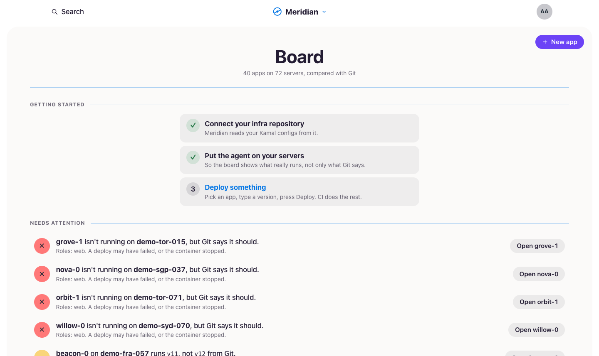

# Meridian

Meridian is an open-source control room for [Kamal](https://kamal-deploy.org): see every app on every server, deploy, roll back, add apps and preview pull requests, with Git as the record of everything.

A meridian is the line navigators measure every position against. Here that line is Git.

<picture>
  <source media="(prefers-color-scheme: dark)" srcset="docs/screenshots/board-dark.png">
  
</picture>

## Install

Try it locally:

```bash
docker run -d -p 3000:80 -v meridian:/rails/storage -e SECRET_KEY_BASE=$(openssl rand -hex 64) -e MERIDIAN_URL=http://localhost:3000 ghcr.io/bigint/meridian:v0.1.0
```

Then open <http://localhost:3000>.

To use it for real, create a GitHub App, deploy Meridian with Kamal (it ships its own `config/deploy.yml`), add your infra repository, and put the agent on your servers. [docs/install.md](docs/install.md) walks through all of it in about 15 minutes.

## Principles

1. **Git is the record.** Every change Meridian makes is a commit or a pull request to your infra repository, written as plain YAML. Uninstalling Meridian loses nothing but its audit trail.
2. **One deploy path.** Meridian commits; CI runs Kamal. Deploy status comes from CI.
3. **Observe, never change, servers.** A read-only agent on each server reaches out to Meridian. Meridian never connects in.
4. **Secrets are write-only.** Meridian stores secret names. Values go straight to GitHub and are never kept.
5. **Generic.** No assumptions about providers, networks or hostnames.
6. **Scale is a feature.** Built for 500 servers and 200 apps from day one.
7. **The Rails way.** Rails 8, Hotwire, SQLite, no Node, no build step, one container.

## How it works

```
Operator ──▶ Meridian ──commits, PRs──▶ GitHub ──Actions──▶ kamal deploy ──SSH──▶ servers
               ▲                         │                                       │
               └────── webhooks ─────────┘     meridian-agent (outbound only) ────┘
```

- **Board:** what needs attention first, in plain sentences; then apps × servers, with each cell's drift state: in sync, drifted, missing, stray, stale or unknown.
- **One menu:** click the name in the top bar, type an app or server name, press Enter.
- **Deploy and roll back:** commit or revert a one-line version file next to the app's Kamal config. CI runs `kamal deploy`.
- **New app:** a form that opens a pull request with a Kamal config for a static, Node (Next.js) or Rails app.
- **Secrets:** names come from your configs. Values are sealed for GitHub Actions secrets.
- **Previews:** each pull request becomes a `pr-<n>` Kamal destination, removed when the pull request closes.

## Documentation

- [Install](docs/install.md)
- [Configuration](docs/configuration.md)
- [The agent](docs/agent.md)
- [Previews](docs/previews.md)
- [Security](docs/security.md)
- [Architecture and Kamal research](docs/architecture.md)
- [Decisions](docs/decisions.md)
- [Design](docs/design.md)
- [Backups with Litestream](docs/litestream.md)

## Development

```bash
bin/setup        # installs gems and prepares the databases (needs libsodium)
bin/rails meridian:demo   # a 500-server demo fleet
bin/dev
bin/ci           # everything CI runs: lint, security, Rails and Go tests
```

See [CONTRIBUTING.md](CONTRIBUTING.md).

## License

MIT. See [LICENSE](LICENSE).
