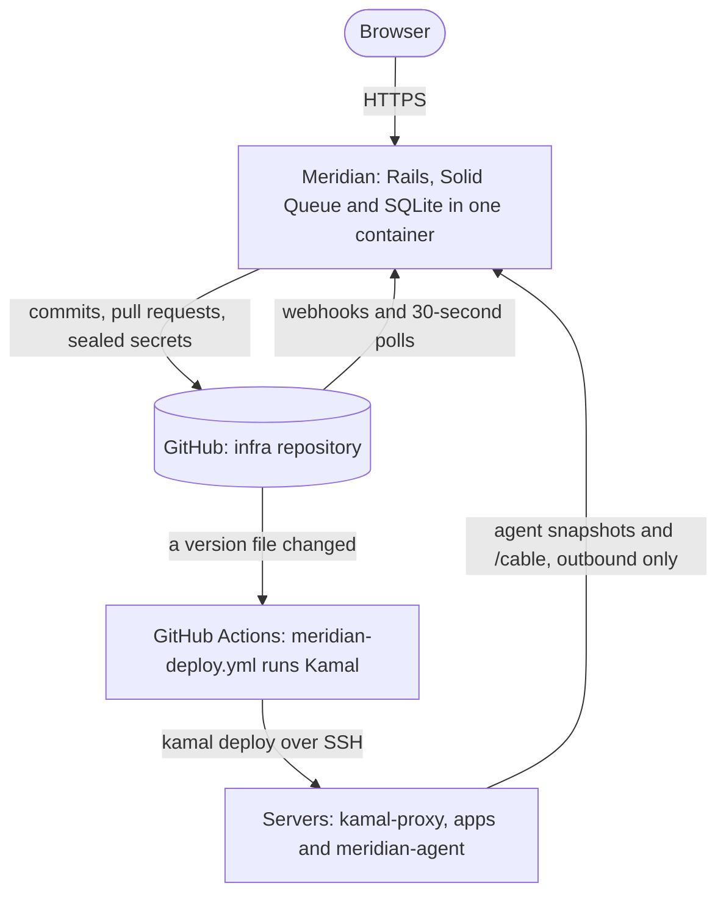
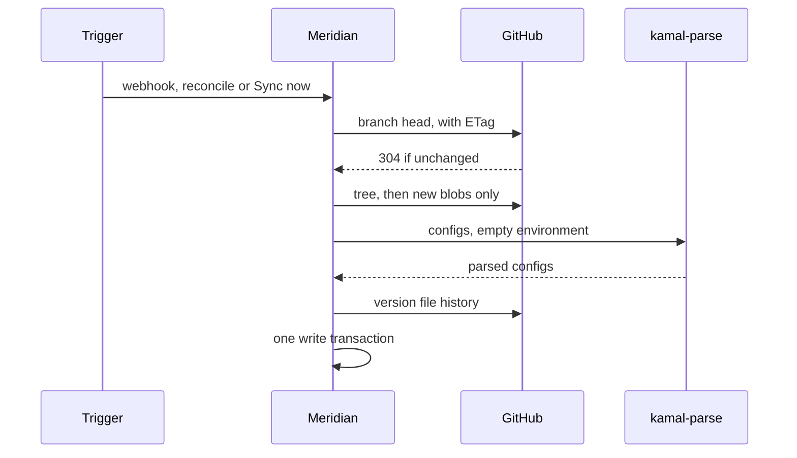
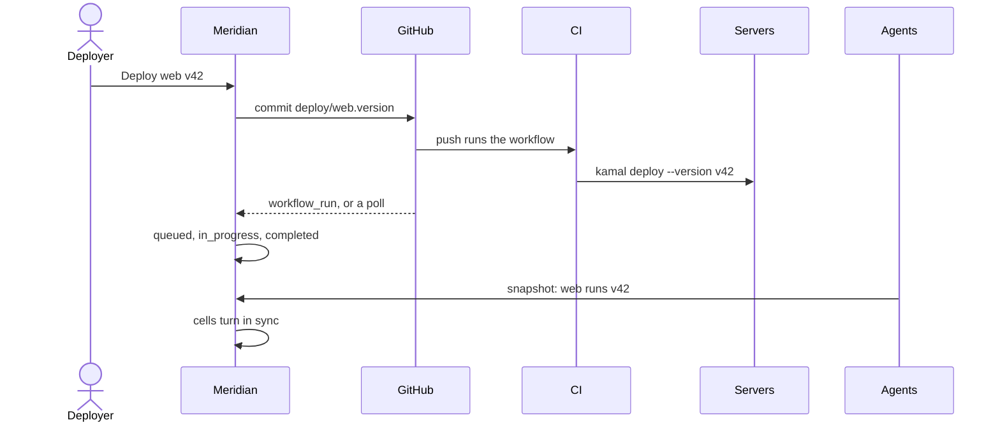

# Architecture

Meridian is one Rails application. It reads Kamal configs from Git, and it reads running containers from a small agent on each server. It writes only to Git. The CI provider runs Kamal, and nothing else does.

Meridian never opens a connection to a server. The agent reads Docker read-only and connects out to Meridian. CI connects to the servers over SSH. GitHub sends `push` and `workflow_run` webhooks, and Meridian polls every 30 seconds as well, so webhooks are optional.

## What should run comes from Git

A sync reads one project's infra repository and records which app should run where, at which version.

1. A sync starts four ways.
   - A `push` webhook for the default branch runs it in `GitHubEventJob`.
   - `ReconcileProjectsJob` enqueues `ProjectSyncJob` for every project every 30 seconds.
   - **Sync now** on a project page enqueues a forced `ProjectSyncJob`, which syncs even when the head hasn't moved.
   - A deploy or a rollback that finds the version file changed in Git enqueues one. So does adding a project, or saving a new repository, branch, installation ID or config paths.

   `ProjectSyncJob` reads Git, then polls the branch's recent workflow runs, so deploys show up without webhooks. Both jobs share one concurrency group per repository, so one repository has one writer at a time.
2. The sync reads the default branch's head SHA. If it equals the last synced SHA, the sync stops there. Each GitHub read carries the last answer's ETag, so an unchanged repository answers `304`, which costs no rate limit.
3. The sync reads the tree at that SHA and keeps the paths that match the project's `config_globs`. A matched `deploy/web.staging.yml` beside a matched `deploy/web.yml` is a destination file, not a config. Matched `.yml` and `.yaml` files count. Blobs are fetched by SHA and cached by SHA, so a blob that hasn't changed is never fetched again.
4. The files are written to a temporary directory, and `bin/kamal-parse` parses them in a separate Ruby process. The process gets an empty environment (only Bundler's paths, `PATH`, `HOME` and `LANG`), the temporary directory as its working directory, and 60 seconds. The script calls `Kamal::Configuration`, the same code that `kamal deploy` runs, so Meridian sees what Kamal sees: ERB, aliases, destinations, roles and accessories. Kamal configs evaluate ERB, and ERB is arbitrary Ruby from the infra repository, so that Ruby must not see Meridian's credentials.
5. For each app whose config, destination file or version file changed, the sync reads its releases: the last 20 commits to its version file. Without a version file, a release is a commit to the destination file, or to the config when there is no destination, named by its short SHA. Meridian never reads `.kamal/secrets` files. Secret names come from the configs' `env.secret` and `registry.password`.
6. Every GitHub read happens before the database transaction, which only writes. SQLite has one writer, and a write lock held across hundreds of API calls would stall every snapshot and sign-in. The transaction upserts these records:
   - `App`: one per config and destination.
   - `Server`: found by hostname, or created as a placeholder until an agent claims it.
   - `Assignment`: one per app, server and role.
   - `Release`: one per commit found in step 5.
   - `SecretName`: one per secret name, with the apps that read it.
7. Parse errors are stored on the project with file, line and message. A config that fails to parse keeps its app as the last good parse left it, with its deploys and releases. Only an app whose config is gone from Git is removed. If the parser itself times out or crashes, nothing is parsed, so every app is kept and the error is stored on the project.

## What does run comes from the agents

1. Every 15 seconds, give or take 20%, each agent POSTs a snapshot to `/agent/snapshots`. A snapshot lists the containers with Kamal labels, with their state, health and version, plus the server's labels and its machine ID.
2. The endpoint checks the bearer token's SHA-256 digest, refuses a body over 1 MiB, validates the snapshot, enqueues it and returns `202`. It allows 120 snapshots a minute per token, or per token and machine for a fleet token, with 12,000 a minute for the whole fleet token.
3. `SnapshotIngestJob` finds or claims the server, upserts its `Placement` rows in one transaction, deletes the placements that have gone, and touches `last_seen_at`.
4. If anything changed, the job asks for a board refresh for the server's region, and for the region it left if its `region` label changed. The refresh is throttled to about one per region per second with two Solid Cache keys. The first change in a second refreshes at once. Later changes in the same second share one refresh when the second ends, so the last change always reaches open pages.
5. `SilentAgentsJob` runs every minute and refreshes the regions of servers whose agents have gone quiet, so they turn stale on screen without a snapshot.

The agent also holds a WebSocket to `/cable`, authenticated with the same token, and subscribes to `AgentChannel` with its machine ID. Meridian sends watch and tail leases down it while someone has a server page, logs or traffic open, and the agent sends stats frames and log batches back. Snapshots stay the only writer. Frames and lines are relayed to browsers and never stored. See [Agent protocol](../docs/reference/agent-protocol.mdx) for the frames and their limits.

## Drift is the difference between the two

Drift is computed when it is read, never stored. `Board` calls `Drift.state` for each app, server and role that Git assigns, and for each running container that Git doesn't assign. A cell shows its worst role, so a stopped `job` container isn't hidden by a running `web` one.

| State | Mark | Means |
| --- | --- | --- |
| In sync | `✓` | Running exactly the version Git says. |
| Drifted | `≠` | Running, but not the version Git says. A deploy may be rolling out, or stopped part-way. |
| Missing | `✕` | Git says it should run here, but nothing is running. |
| Stray | `?` | Running here, but Git doesn't put it here. |
| Stale | `…` | The server's agent has gone quiet, so Meridian can't tell what runs there right now. |
| Unknown | `–` | Nothing to compare yet: no agent on the server, or no version file for the app. |

In the board's grid a cell shows the version it runs. A missing cell shows `✕`, a drifted one `≠` and the version, and an unknown one `–`. A stray cell has a dotted border, and a stale or unknown one a dashed border.

`Drift.state` decides in this order:

1. The server's agent has never reported: `unknown` if Git assigns the app there, and no cell otherwise.
2. The agent has been silent for more than three of its intervals, and never under 45 seconds: `stale`.
3. Git doesn't assign the app there but a container runs: `stray`.
4. Git assigns it and nothing runs: `missing`.
5. The app has no comparable release: `unknown`.
6. Every running container has the newest release's version: `in_sync`. Otherwise: `drifted`.

**Needs attention** ranks `missing`, `drifted`, `stray`, then `stale`. The board, the map and a place's worst state all use that one order.

## Changes go to Git, never to servers

- **Deploy** is a contents-API commit to the app's version file, `<config>.version` or `<config>.<destination>.version`. It passes the file's current blob SHA, so a concurrent change fails instead of being overwritten. The message is `deploy(<service>[-<destination>]): <version>`, then a `Meridian-Actor: Name <email>` trailer.
- **Roll back** reverts the newest release only. Meridian checks with Git that the release is still the newest commit to the version file, then writes the content the file had at that commit's parent. The message is `rollback(<service>[-<destination>]): <previous version>`, with `This reverts commit <sha>.` in the body and the same trailer.
- **Redeploy** changes no file. It dispatches the deploy workflow (`workflow_dispatch`) with the version the version file holds at that moment.
- **New apps, tunnel connector changes and the CI workflow** arrive as pull requests on a `meridian/<slug>-<hex>` branch. A project setting lets admins commit them straight to the default branch instead.
- **Deploy status** comes from the deploy workflow's runs (`.github/workflows/meridian-deploy.yml`; other workflows are ignored). Runs arrive through `workflow_run` webhooks and the 30-second poll, and both go through `Project#track_workflow_run`. A run is matched to apps by its `head_sha`; a dispatched run is matched by its run name, `<command> <config> <destination>`. A `Deploy` moves through `pending`, `queued`, `in_progress` and `completed`.
- **Per-server progress** comes from the agents, not from CI. Kamal deploys every host in one CI job, so a server is done when its agent reports the target version running there.

## Jobs

Solid Queue runs inside Puma unless `SOLID_QUEUE_IN_PUMA` is `false`. Recurring jobs come from `config/recurring.yml`.

| Job | When | What it does |
| --- | --- | --- |
| `ReconcileProjectsJob` | Every 30 seconds | Enqueues `ProjectSyncJob` for every project. |
| `ProjectSyncJob` | Reconcile, **Sync now**, a project added or edited, a deploy or rollback that hit a change in Git | Syncs Git, then polls the deploy workflow's runs. |
| `GitHubEventJob` | Each signed webhook | `push` syncs, `workflow_run` tracks a run. |
| `SnapshotIngestJob` | Each accepted snapshot | Records the server and its placements, then refreshes the board. |
| `BoardRefreshJob` | The end of a throttled second | Sends the trailing board refresh. |
| `SilentAgentsJob` | Every minute | Refreshes the regions of servers whose agents went quiet. |

Finished Solid Queue jobs are cleared every hour at minute 12.

## Domain model

These are the tables in `db/schema.rb`.

| Model | What it is |
| --- | --- |
| `Account` | The single row that holds settings: workspace name and where Meridian runs. |
| `User` | Email and password (Rails 8 authentication). Role is `viewer`, `deployer` or `admin`. |
| `Session` | One signed-in browser. |
| `Project` | One infra repository. It holds the GitHub installation, branch, config globs, the last synced SHA and parse errors. |
| `App` | One Kamal config and destination. It holds the service, config path, kind, hostnames, roles, accessories, secret names and source repository. |
| `Server` | One machine, unique by the `machine_id` its agent reports, and by hostname before that. It holds labels, location, agent version, interval and last-seen time. |
| `Assignment` | An app that Git says should run on a server, in a given role. |
| `Placement` | A container that an agent says is running on a server. The row is upserted, never appended. |
| `Release` | One commit that changed what an app should run. It holds version, SHA, author, time and message. |
| `Deploy` | One CI run for one app: a deploy, rollback or redeploy, with its status. |
| `SecretName` | The name of a secret and the apps that reference it. **It never holds a value.** |
| `AgentToken` | A bearer token, stored only as a SHA-256 digest, either bound to one server or a fleet token. |
| `Event` | The audit trail of everything Meridian did, and who did it. |

Some models have no table. `Board`, `Drift` and `WorldMap` compute views from the tables. `Snapshot` validates and ingests what an agent sent. `Tunnel` and `Accessory` read Cloudflare connectors and other accessories from configs and placements. `KamalConfig` runs the parser. `LiveStats`, `LiveLogs` and `LiveTraffic` check and relay what flows over the live line. `GitHost::GitHub` is the only code that talks to GitHub.

## Kamal and kamal-proxy findings

Meridian pins **kamal 2.12.0** and has been checked against **kamal-proxy 0.10.3**. In the links below, K is `https://github.com/basecamp/kamal/blob/v2.12.0/` and P is `https://github.com/basecamp/kamal-proxy/blob/v0.10.3/`.

### Labels and container names

- **Default labels.** App containers get the labels `service`, `role` and `destination` ([K lib/kamal/configuration/role.rb#L212-L214](https://github.com/basecamp/kamal/blob/v2.12.0/lib/kamal/configuration/role.rb#L212-L214)). Custom `labels:` set at the top level and then on the role are merged on top ([#L54-L60](https://github.com/basecamp/kamal/blob/v2.12.0/lib/kamal/configuration/role.rb#L54-L60), [#L232-L237](https://github.com/basecamp/kamal/blob/v2.12.0/lib/kamal/configuration/role.rb#L232-L237)). Role and accessory labels may not use the reserved names ([K validator.rb#L222-L232](https://github.com/basecamp/kamal/blob/v2.12.0/lib/kamal/configuration/validator.rb#L222-L232)).
- **No destination.** Kamal then emits a bare `--label destination` ([K utils.rb#L9-L21](https://github.com/basecamp/kamal/blob/v2.12.0/lib/kamal/utils.rb#L9-L21)), which Docker stores as `destination=""`.
- **Container name.** The name is `[service, role, destination].compact.join("-")` followed by `-<version>` ([role.rb#L124-L130](https://github.com/basecamp/kamal/blob/v2.12.0/lib/kamal/configuration/role.rb#L124-L130)).
- **Version.** There is no version label. Kamal reads the version back by stripping the prefix from the name ([K commands/app.rb#L107-L110](https://github.com/basecamp/kamal/blob/v2.12.0/lib/kamal/commands/app.rb#L107-L110)), and the agent does the same.
- **Accessories.** They are named and labelled `service=<service>-<accessory>` ([K accessory.rb#L26-L28](https://github.com/basecamp/kamal/blob/v2.12.0/lib/kamal/configuration/accessory.rb#L26-L28)).
- **The proxy.** The proxy container is named `kamal-proxy` and carries no Kamal labels ([K commands/proxy.rb#L10-L25](https://github.com/basecamp/kamal/blob/v2.12.0/lib/kamal/commands/proxy.rb#L10-L25)). The agent recognises it by name.

### kamal-proxy routes, read-only

- **The state file.** kamal-proxy writes its services to `$HOME/.config/kamal-proxy/kamal-proxy.state` ([P internal/server/config.go#L34-L65](https://github.com/basecamp/kamal-proxy/blob/v0.10.3/internal/server/config.go#L34-L65)). The file is a JSON array of `{name, options: {hosts, path_prefixes, tls_enabled, …}, active_targets, …}` ([P service.go#L325-L340](https://github.com/basecamp/kamal-proxy/blob/v0.10.3/internal/server/service.go#L325-L340)). Older versions wrote `hosts` and `active_target` at the top level ([#L410-L422](https://github.com/basecamp/kamal-proxy/blob/v0.10.3/internal/server/service.go#L410-L422)).
- **Where it lives.** Kamal mounts that directory from the **named volume `kamal-proxy-config`** ([K commands/proxy.rb#L18](https://github.com/basecamp/kamal/blob/v2.12.0/lib/kamal/commands/proxy.rb#L18)). The directory has mode 0700.
- **Partial writes.** The file is rewritten in place, not atomically ([P router.go#L407-L429](https://github.com/basecamp/kamal-proxy/blob/v0.10.3/internal/server/router.go#L407-L429)), so a reader can see half a file.
- **Other ways to list routes.** `kamal-proxy list` uses a unix socket inside the container ([P cmd/list.go](https://github.com/basecamp/kamal-proxy/blob/v0.10.3/internal/cmd/list.go#L20-L60)), so reaching it requires `docker exec`. kamal-proxy has no HTTP endpoint that lists routes.
- **Conclusion.** Route reporting is possible read-only, by mounting `kamal-proxy-config` read-only into an agent running as root so it can read the 0700 directory. The agent did this until Meridian found it never used the routes. See [decision 35](decisions.md#35-agents-no-longer-report-kamal-proxy-routes). The agent ignores `MERIDIAN_PROXY_STATE` now.

### Destination files

- **Overlay file.** `-c path/foo.yml -d staging` loads `path/foo.staging.yml` ([K configuration.rb#L49-L51](https://github.com/basecamp/kamal/blob/v2.12.0/lib/kamal/configuration.rb#L49-L51)). Each file is rendered with ERB, loaded as YAML and deep-merged over the base ([#L28-L47](https://github.com/basecamp/kamal/blob/v2.12.0/lib/kamal/configuration.rb#L28-L47)). An overlay may override any key, `service` included.
- **Secrets.** Kamal reads them from `.kamal/secrets-common`, then from `.kamal/secrets`, or `.kamal/secrets.<dest>` with a destination, resolved against the **working directory** rather than the config's own directory ([K secrets.rb#L37-L45](https://github.com/basecamp/kamal/blob/v2.12.0/lib/kamal/secrets.rb#L37-L45)). A missing file is not an error. Meridian never fetches these files, so the parser sees none.

### Parsing without SSH, secrets or git

- **The call.** `Kamal::Configuration.create_from(config_file: Pathname, destination:, version:)` ([K configuration.rb#L20-L26](https://github.com/basecamp/kamal/blob/v2.12.0/lib/kamal/configuration.rb#L20-L26)) reads secrets lazily.
- **Version.** Passing a version stops Kamal from shelling out to git ([#L450-L460](https://github.com/basecamp/kamal/blob/v2.12.0/lib/kamal/configuration.rb#L450-L460)). Meridian passes `"0"`.
- **Errors.**
  - Invalid configs raise `Kamal::ConfigurationError`, whose message carries a key path such as `servers/web/hosts`, but no line number ([K validator.rb#L183-L198](https://github.com/basecamp/kamal/blob/v2.12.0/lib/kamal/configuration/validator.rb#L183-L198)).
  - Bad YAML raises `Psych::SyntaxError`, which does carry a line.
  - Meridian maps key paths to lines itself, from the YAML node tree.
