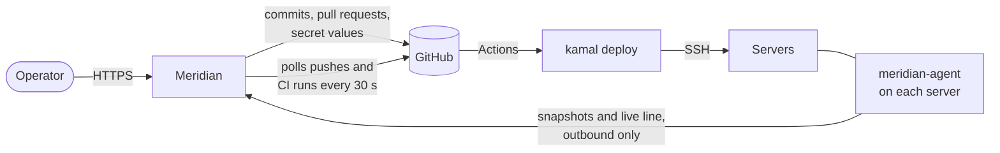
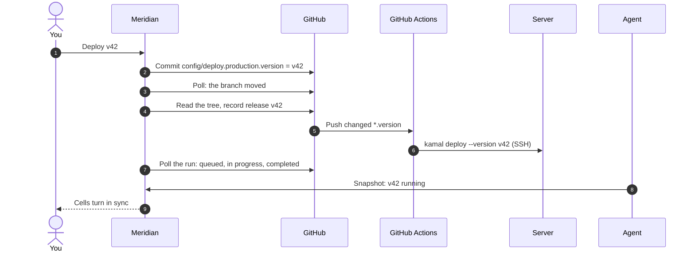

Meridian shows what runs on your servers and lets you change it. This page explains the whole model, then follows one deploy from start to finish.

## The idea

Meridian compares two lists. Git says what should run on each server. A small program on each server, the [agent](/reference/glossary#agent), says what does run. The difference between the two lists is [drift](/reference/glossary#drift), and the board is built from it.

Meridian never touches a server. To change what runs, it writes to Git. GitHub Actions sees the change and runs [Kamal](/reference/glossary#kamal), a tool that deploys apps as Docker containers to your own servers over SSH.



## Words this page uses

| Word | What it means |
| --- | --- |
| [Infra repository](/reference/glossary#infra-repository) | The Git repository that holds your Kamal configs. Meridian reads it and writes to it. Each one you add is a [project](/reference/glossary#project). |
| [Config](/reference/glossary#config) | A Kamal file, such as `config/deploy.yml`, that says what an app is and which servers run it. |
| [App](/reference/glossary#app) | One config plus one [destination](/reference/glossary#destination), such as `production`. |
| [Version file](/reference/glossary#version-file) | A one-line file next to a config that holds the [version](/reference/glossary#version) to run, such as `v42`. Meridian deploys by changing it. |
| [Release](/reference/glossary#release) | A commit that changed an app's version file. The newest release is what Git says should run. |

## One deploy, start to finish

Take one app, `shop · production`, in the infra repository `acme/infra`. It has a config, a destination file and a version file:

<Tree>
  <Tree.Folder name="config" defaultOpen>
    <Tree.File name="deploy.yml" />
    <Tree.File name="deploy.production.yml" />
    <Tree.File name="deploy.production.version" />
  </Tree.Folder>
</Tree>

The version file holds `v41`, and the server `web-1` runs `v41`, so the board shows **in sync**. You want to ship `v42`, an image your app's CI has already built.

<Steps>
  <Step title="You press Deploy">
    On the app's page, you type `v42` in **Ship a version** and press **Deploy**.
  </Step>
  <Step title="Meridian commits the version">
    Meridian writes `v42` into `config/deploy.production.version`, in one commit on the default branch:

    ```text
    deploy(shop-production): v42

    Meridian-Actor: Ada Lovelace <ada@example.com>
    ```
  </Step>
  <Step title="Git now says v42">
    Within 30 seconds, Meridian's poll sees that the branch moved. Meridian records release `v42`. The server still runs `v41`, so the cell turns **drifted**.
  </Step>
  <Step title="GitHub Actions runs Kamal">
    The [CI workflow](/reference/glossary#ci-workflow), `.github/workflows/meridian-deploy.yml`, sees that a version file changed. It runs `kamal deploy -c config/deploy.yml -d production --version v42 --skip-push`. Kamal connects to `web-1` over SSH, as it would from your laptop.
  </Step>
  <Step title="Meridian follows the run">
    Meridian shows the run's status under **Current deploy** on the app's page: queued, in progress, then completed.
  </Step>
  <Step title="The agent sees v42">
    The agent on `web-1` reports that `shop` runs `v42`. Git and the server agree, so the cell turns **in sync**.
  </Step>
</Steps>



A rollback works the same way. Meridian commits the previous version, and CI deploys it. See [Versions and releases](/concepts/versions-and-releases).

## Where "should run" comes from

Meridian reads each infra repository through the GitHub API. This read is a sync. It runs every 30 seconds, and when you press **Sync now**.

Meridian reads each config with Kamal's own code, so it sees what `kamal deploy` would see. A config that fails to parse shows its file and line on the project's page. Its app keeps the last good parse. See [Apps and destinations](/concepts/apps-and-destinations).

## Where "does run" comes from

By default, each agent sends Meridian a snapshot every 15 seconds. A snapshot lists the containers that Kamal started, with their state, health and version. The agent only reads, and it only connects out. Meridian holds no SSH key. See [Servers and agents](/concepts/servers-and-agents).

## Drift is the difference

For every app on every server, Meridian compares the agent's report with the newest release in Git. Each cell gets one of six states: in sync, drifted, missing, stray, stale or unknown. Open pages update themselves. [Drift](/concepts/drift) has the exact rules.

## Every change goes to Git

| You do | Meridian writes |
| --- | --- |
| Deploy | A commit that puts the version in the app's version file, on the default branch. |
| Roll back | A commit that puts back the version file's previous value. |
| Redeploy | A request to run the deploy workflow again, for the version already in the file. |
| New app, CI workflow, tunnel connectors | A pull request on a `meridian/…` branch, or a direct commit when the project allows it. |
| Secret value | An encrypted GitHub Actions secret on the repository. Meridian keeps the name only. |

A commit that you asked for names you in a `Meridian-Actor:` line. Every action shows in [Activity](/guides/activity).

GitHub never calls Meridian. Meridian polls it, and finds each change within 30 seconds.

## What Meridian never does

- It never opens an SSH connection, and it never runs Kamal itself.
- It never stores, logs or shows a secret value.
- It never reads `.kamal/secrets` files, because they can hold real secret values.
- It never changes a server.

If you uninstall Meridian, Git still holds every config, version and deploy. You lose only the activity log, your account, agent tokens and settings.

<Accordion title="How this works under the hood">
  A sync never clones the repository. It lists the files at the head of the default branch and keeps the ones that match the project's config paths. It downloads each file once and caches it by its Git SHA, the ID Git gives each file's contents. It also asks GitHub whether the branch changed since the last answer, so an unchanged repository costs no API quota.

  Configs can hold ERB, which is Ruby code from your repository. So the parser, `bin/kamal-parse`, runs as a separate process with an empty environment. It can't read Meridian's credentials.

  An agent's snapshot goes to `/agent/snapshots`. Meridian answers `202` and records it in a background job. The agent spaces its snapshots 15 seconds apart, give or take 20%. It reads Docker through a proxy that allows only `GET` requests under `/containers`. Live stats, logs and requests travel over a WebSocket to `/cable`, only while someone has the page open.

  A deploy's status comes from the deploy workflow's runs. Meridian matches a run to an app by its commit SHA. It checks the branch's runs every 30 seconds. When a snapshot changes what a page shows, Meridian refreshes open boards for that server's region, at most about once a second.
</Accordion>

## Related

<Columns cols={2}>
  <Card title="Drift" icon="split" href="/concepts/drift">
    The six states, and the exact rule behind each one.
  </Card>
  <Card title="Architecture" icon="book-open" href="https://github.com/bigint/meridian/blob/main/contributing/architecture.md">
    The data flow, the domain model and the Kamal research behind it.
  </Card>
</Columns>
