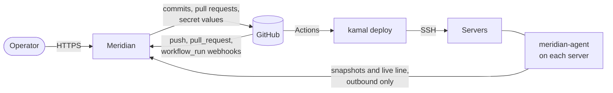
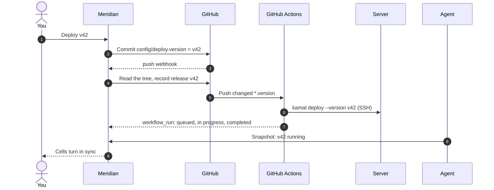

Meridian holds two pictures of your fleet and compares them. Git says what should run where. A small agent on each server says what does run there. The difference between the two is [drift](/concepts/drift), and the board is built from it.

Meridian never acts on a server. To change what runs, it writes to Git, and your CI runs Kamal.

## What should run comes from Git

A [project](/guides/projects) is one infra repository. Meridian syncs it when one of these happens:

- GitHub sends a `push` webhook for the default branch.
- The reconcile job runs. It runs every 30 seconds for every project.
- An admin presses **Sync now** on the project's page.

A sync reads the repository through the GitHub API. It never clones it. It lists the tree at the head of the default branch and keeps the files that match the project's config paths, with their destination files and version files. Blobs are cached by SHA, so an unchanged file is never downloaded twice. Each GitHub request carries the ETag of the last answer, and an unchanged repository costs no rate limit.

Meridian then parses the configs with Kamal's own code, `Kamal::Configuration`, the same code `kamal deploy` runs. ERB, aliases, destinations, roles and accessories come out as Kamal sees them. ERB in a config is Ruby from your repository, so the parser runs as `bin/kamal-parse` in a separate process with an empty environment. It can't read Meridian's credentials.

From the parsed configs, the sync records:

| Record | One per |
| --- | --- |
| App | Config and destination. See [Apps and destinations](/concepts/apps-and-destinations). |
| Server | Host that a config's roles name, until an agent claims it. See [Servers and agents](/concepts/servers-and-agents). |
| Assignment | App, server and role that Git places together. |
| Release | Commit that changed the app's version file. See [Versions and releases](/concepts/versions-and-releases). |

A config that fails to parse shows its error with a file and line on the project's page. Its app stays as the last good parse left it. Only an app whose config is gone from Git is removed.

## What does run comes from the agents

Every 15 seconds, give or take 20%, each agent sends a snapshot to `/agent/snapshots`. A snapshot lists the containers that carry Kamal labels, with their state, health and version. Meridian answers `202` and records the snapshot in a background job. The server's placements are upserted, the ones that went away are deleted, and the server's last-seen time moves on.

The agent only makes outbound requests. It reads Docker through a socket proxy that allows listing and inspecting containers and nothing else. Meridian never connects to a server, and it holds no SSH key.

The agent also keeps a WebSocket open to `/cable`. Meridian uses it for live CPU and memory figures, container logs and request traffic, and only while someone has that page open. See [Live stats and logs](/guides/live-stats-and-logs).

## Drift is the difference

Drift is computed each time a page reads it. It is never stored. For every app on every server, Meridian compares the versions the agent reports with the newest release in Git, and gives the cell one of six states: in sync, drifted, missing, stray, stale or unknown. [Drift](/concepts/drift) has the exact rules.

Pages update themselves. When a snapshot changes what a page shows, Meridian refreshes open boards for that server's region, at most about once a second.

## Changes go to Git, never to servers

Every change Meridian makes lands in your infra repository or in GitHub's settings for it:

| Action | What Meridian writes |
| --- | --- |
| Deploy | A commit that puts the version in the app's version file, on the default branch. |
| Roll back | A commit that puts back the version file's previous value. |
| Redeploy | A `workflow_dispatch` of the deploy workflow, for the version already in the file. |
| New app, CI workflow, tunnel connectors | A pull request on a `meridian/…` branch, or a direct commit when the project allows it and an admin acts. |
| Preview | A destination file `<config>.pr-<n>.yml` and a `workflow_dispatch`. |
| Secret value | An encrypted GitHub Actions secret on the repository. Meridian keeps the name only. |

A commit that a person asked for carries a `Meridian-Actor:` trailer with their name and email. Preview commits come from webhooks and have none. Every action lands in [Activity](/guides/activity).

CI does the deploying. The workflow that Meridian adds, `.github/workflows/meridian-deploy.yml`, runs on any push that changes a `*.version` file and calls `kamal deploy` once for each config and destination that changed. Kamal connects to your servers over SSH from the runner, exactly as it would from your laptop. See [CI workflow](/reference/ci-workflow).

## A deploy, end to end

The deploy's status comes from the workflow's runs. Meridian matches a run to an app by its commit SHA, through `workflow_run` webhooks and by polling the branch's runs every 30 seconds. Progress on each server comes from the agents. A server is done when its agent reports the new version running.

## Webhooks are optional

Webhooks make Meridian react within a second or two. Without them, the reconcile job finds the same pushes and workflow runs within 30 seconds. Pull request previews are the exception. They start from a `pull_request` webhook and need one.

## What Meridian never does

- It never opens an SSH connection, and it never runs Kamal itself.
- It never stores, logs or shows a secret value.
- It never reads `.kamal/secrets` files, which may hold literal values.
- It never changes a server. The agent's Docker access is read-only.

Uninstall Meridian and your infra repository still holds every config, version and deploy commit. You lose only its activity log.

## Related

<Columns cols={2}>
  <Card title="Drift" icon="split" href="/concepts/drift">
    The six states, and the exact rule behind each one.
  </Card>
  <Card title="Architecture" icon="book-open" href="/internals/architecture">
    The data flow, the domain model and the Kamal research behind it.
  </Card>
</Columns>
