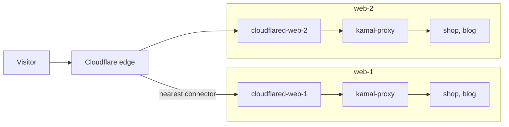

One Cloudflare Tunnel can serve every app, with a connector on each server and no open ports. Meridian walks you through it in your project's own names, and then watches the tunnel from Git and the agents. It never calls Cloudflare's API. It writes plain YAML to Git, keeps only the token's secret name, and assumes nothing about your network. You create the tunnel and its routes in Cloudflare yourself.

## How it works



- **One tunnel, one token.** The token lives in the repository secret `CLOUDFLARE_TUNNEL_TOKEN`. cloudflared reads `TUNNEL_TOKEN`, so the connectors alias it: `TUNNEL_TOKEN:CLOUDFLARE_TUNNEL_TOKEN`.
- **A connector on each server.** One config runs only accessories: one `cloudflared-<server>` per server, each with its own `hostname`, so Cloudflare lists every replica by server name. Its `meridian.kind: accessories` label keeps it off the board, and Meridian never deploys an app from it.
- **Every hostname to kamal-proxy.** The tunnel routes each app's hostname to `http://kamal-proxy:80`. Accessories share Kamal's `kamal` Docker network, where the proxy container is named `kamal-proxy`, and kamal-proxy routes by `Host`.

<Warning>
Cloudflare sends each request to whichever connector is nearest, not to the server that runs the app. So every connector's server must run every app the tunnel serves, or kamal-proxy answers `404`. Run your apps on the connector servers before you route them.
</Warning>

Meridian finds a tunnel in Git: every accessory whose image starts with `cloudflare/cloudflared`, grouped by the secret its token comes from. A tunnel whose connectors live in one config is named after that config's service.

## Set up a tunnel

Open **Tunnels** under **Manage**, and click **Set up a tunnel**. The page shows seven steps, filled in with your project's names. Steps Meridian can see tick themselves off: the token set from its Secrets page, the connectors in Git, and the connectors running.

On the right, pick the **Project** and the **Connector servers**. Every server that runs one of the project's apps is listed, with how many apps it runs. The page regenerates the connector config for the servers you tick, and warns about every app that isn't on all of them. **Ready to route** lists the apps that are.

The steps match the Cloudflare dashboard as of November 2026.

<Steps>
  <Step title="Create the tunnel">
    In Cloudflare, open **Networking → Tunnels** and click **Create Tunnel**. The page suggests a **Tunnel name**, your project's name by default.
  </Step>
  <Step title="Copy its token">
    Under **Install cloudflared connector**, choose **Docker** and copy the command. Keep only the long value after `--token`. Don't run the command. Kamal runs a connector on each server in step 5.
  </Step>
  <Step title="Save the token">
    On Meridian's [Secrets](/guides/secrets) page, set `CLOUDFLARE_TUNNEL_TOKEN`. Add this line to `.kamal/secrets`, so Kamal can read it:

    ```bash .kamal/secrets
    CLOUDFLARE_TUNNEL_TOKEN=$CLOUDFLARE_TUNNEL_TOKEN
    ```
  </Step>
  <Step title="Add the connectors">
    Commit the config the page shows. It goes where the project's first config glob puts the service `edge`, such as `config/deploy-edge.yml` with the default glob, or `deploy/edge.yml` with `deploy/*.yml`. The template is `templates/kamal/edge.yml`.
  </Step>
  <Step title="Start them">
    From a machine that can SSH to the servers, with `CLOUDFLARE_TUNNEL_TOKEN` in its environment, run:

    ```bash
    kamal accessory boot all -c config/deploy-edge.yml
    ```

    `kamal deploy` doesn't start accessories. Each connector should register four connections.
  </Step>
  <Step title="Route each app's hostname">
    On the tunnel's **Routes** tab, add a **Published application** for each hostname, all to `http://kamal-proxy:80`. The page lists the hostnames of every app that is ready.

    Cloudflare creates the DNS record, though not always. In testing it skipped 3 of 6. Check **DNS → Records**. If one is missing, add a proxied CNAME to `<tunnel ID>.cfargotunnel.com`.
  </Step>
  <Step title="Check it">
    The **Tunnels** page shows every connector running and no app missing from a connector's server. Cloudflare shows the tunnel **Healthy**, with one replica per server.
  </Step>
</Steps>

### The connector config

For two servers, with the default glob, the page generates:

```yaml config/deploy-edge.yml
# Cloudflare Tunnel infra: a connector on each server below.
# They all read the tunnel's token from CLOUDFLARE_TUNNEL_TOKEN.
# Generated by Meridian; edit it like any Kamal config.
#
# Accessories only: never `kamal deploy` this file. Start the connectors with
#   kamal accessory boot all -c config/deploy-edge.yml
#
# The tunnel routes each app's hostname to http://kamal-proxy:80, which routes
# by Host. Cloudflare sends each request to the nearest connector, so every
# server here must run every app the tunnel serves.
service: edge
image: edge   # unused: no app runs from this file

# Tells Meridian this config runs only accessories, so the board leaves it out.
labels:
  meridian.kind: accessories

servers:
  web:
    proxy: false
    hosts:
      - web-1.example.com
      - web-2.example.com

# Required by Kamal; the connector image comes from Docker Hub.
registry:
  server: localhost:5555

builder:
  arch: amd64

x-cloudflared: &cloudflared
  image: cloudflare/cloudflared:2026.11.2
  cmd: tunnel --no-autoupdate run
  env:
    secret:
      - TUNNEL_TOKEN:CLOUDFLARE_TUNNEL_TOKEN

accessories:
  cloudflared-web-1:
    <<: *cloudflared
    host: web-1.example.com
    options:
      hostname: web-1

  cloudflared-web-2:
    <<: *cloudflared
    host: web-2.example.com
    options:
      hostname: web-2
```

Each connector is named after its server's first DNS label. A server known by IP address uses the whole address, with dashes, such as `cloudflared-10-0-0-1`. When two servers share a first label, such as `web.sgp.example.com` and `web.fra.example.com`, both use their whole name: `cloudflared-web-sgp-example-com`.

### Hostnames that need care

- **Keep hostnames one level below the domain.** Cloudflare's free certificate covers `app.example.com`, not `app.team.example.com`.
- **Serve a hostname the app doesn't answer to** by setting **HTTP Host Header** to one it does, under **Additional application settings → HTTP**. kamal-proxy routes by `Host`, and apps such as nginx sites and Rails check it too.

## The Tunnels page

**Tunnels** shows each tunnel, problems first. Its header says how many tunnels there are, and how many need attention.

Each tunnel shows its name, repository and config, and three facts:

- **Token**: the secret's name, with `set` when Meridian set it, or `not set here`. Meridian can't tell whether a value set on GitHub directly exists.
- **Connectors**: how many of them run.
- **Serves**: how many apps run on every connector's server.

**Connectors** lists one connector per server, each in one state:

| State | Means |
| --- | --- |
| `running` | The agent reports the connector running. |
| A Docker state, such as `exited` | The container exists, but doesn't run. |
| `not started` | The server's agent reports, without that container. The page shows the `kamal accessory boot` command for it. |
| `unknown` | Meridian doesn't know the server, or its agent hasn't reported lately. |

**Apps it can serve** lists apps that run on every connector's server, in a role behind kamal-proxy. A server that runs only an app's workers has no route for it. An app on only some of the servers gets a warning, such as **Don't route shop through this tunnel yet**, naming the servers it is missing from. Meridian can't see Cloudflare's routes, so this is advice, not an error. Apps on no connector's server are listed quietly below.

**Steps** opens the setup page for the tunnel's project.

## Edit connectors

Admins can change which servers run a connector. Click **Edit connectors** on a tunnel. It shows only for a tunnel whose connectors live in one config.

<Steps>
  <Step title="Tick the servers">
    Under **Connector servers**, tick and untick servers. The current ones carry the `now` badge. The page previews the change at once: `+ add` and `− remove` for each server, and a warning for every app the new set of servers doesn't all run.
  </Step>
  <Step title="Propose the change">
    Click **Open a pull request**, or **Commit the change** where the project allows direct commits. The title reads like `feat(edge): add web-3.example.com as Cloudflare Tunnel connectors`.
  </Step>
  <Step title="Stop the dropped connectors, before you merge">
    Run the `kamal accessory remove` command the page gives for each dropped connector. Once the change is merged, Kamal no longer knows them.
  </Step>
  <Step title="Start the new ones, after you merge">
    Run the `kamal accessory boot` command the page gives, with `CLOUDFLARE_TUNNEL_TOKEN` in the environment. Each should register four connections, and Cloudflare lists it under its server's name.
  </Step>
</Steps>

Meridian edits the connector config's own text instead of regenerating it. Everything else in it stays as it was: other accessories, such as a health check or a log agent, anchors, and comments.

- **An added server** gets a copy of an existing connector entry, with its host and hostname swapped in. It is named the way the file already names them. Next to `cloudflared-blr-01` for `kamal-blr-01`, the server `kamal-fra-01` gets `cloudflared-fra-01`. A taken name gets `-2`, `-3`, and so on.
- **A dropped server** loses its entry, and the comments just above it.
- **The primary role's server list** follows, except that a server stays listed while another accessory still runs there.

Kamal checks the result before anything is proposed. It must start connectors on exactly the ticked servers, and leave every other accessory alone. A change Meridian can't make says why, such as a connector entry that lists several hosts. Edit those in Git.

Routes and the token stay in Cloudflare.

## Previews behind a tunnel

Previews are named `pr-<n>.<app>.<preview domain>` by default, two levels below the domain, which Cloudflare's free certificate doesn't cover. The **Previews** card on the Tunnels page warns about it.

<Steps>
  <Step title="Switch to flat hostnames">
    In **Settings**, under **Previews**, set **Hostnames** to `pr-<n>-<app>.<domain>`. Only new and reopened previews change.
  </Step>
  <Step title="Route the wildcard">
    Give the tunnel a wildcard route, `*.<preview domain>` to `http://kamal-proxy:80`, and a proxied wildcard CNAME, `*.<preview domain>` to `<tunnel ID>.cfargotunnel.com`.
  </Step>
  <Step title="Run previews on the connector servers">
    Set **Preview servers** to a selector that matches the connector servers, so every preview runs where the tunnel can reach it.
  </Step>
</Steps>

See [Previews](/guides/previews#hostnames).

## Traffic behind a tunnel

Every request reaches kamal-proxy from `cloudflared`, so an app's [Traffic](/guides/traffic) page can't tell visitors apart unless kamal-proxy logs Cloudflare's headers. Apps created with **New app** in a project with a tunnel get this in their config. Add it to older ones, and deploy:

```yaml config/deploy.yml
proxy:
  logging:
    request_headers:
      - Cf-Connecting-Ip
      - Cf-Ipcountry
      - Cf-Ray
```

Each request then shows the visitor's address and country, and the Cloudflare location it came through, the last part of `Cf-Ray`, such as `SIN`.

## Meridian behind a tunnel

GitHub's webhooks and the agents must reach Meridian. To serve Meridian through the tunnel:

1. Run Meridian on the connector servers.
2. Add a route for its hostname to `http://kamal-proxy:80`.
3. Set `proxy.ssl: false` in Meridian's Kamal config, because Cloudflare terminates TLS.

`MERIDIAN_URL` stays the public `https://` URL. Agents connect out over HTTPS and keep one WebSocket to `/cable`. Both work through a tunnel.

## Related

<Columns cols={2}>
  <Card title="Secrets" icon="key-round" href="/guides/secrets">
    Set the tunnel's token.
  </Card>
  <Card title="Previews" icon="git-pull-request" href="/guides/previews">
    Flat hostnames and preview servers.
  </Card>
</Columns>
