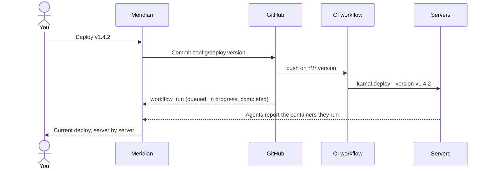

To deploy, you pick a version and click **Deploy**. Meridian writes that version into the app's [version file](/reference/glossary#version-file), a one-line file in your [infra repository](/reference/glossary#infra-repository). The [CI workflow](/reference/glossary#ci-workflow) in GitHub Actions sees the change and runs `kamal deploy`. [Kamal](/reference/glossary#kamal) is the tool that puts your app's containers on your servers. Meridian never connects to your servers itself.



## Before you start

- The infra repository has the CI workflow, `.github/workflows/meridian-deploy.yml`. Add it with **Add CI workflow** on the project page. See [Projects](/guides/projects#add-the-ci-workflow).
- The image for the version is already in your registry. The workflow runs `kamal deploy --skip-push`, so it never builds or pushes an image. Your source repository's CI does that.
- To watch each server pick up the version, it runs the [agent](/reference/glossary#agent), a small program that reports what runs there. See [Install the agent](/guides/agent).

## Deploy a version

<Steps>
  <Step title="Open the app">
    Open **Apps** and pick the app, or click the app's name on the board.
  </Step>
  <Step title="Type the version">
    Under **Ship a version**, type the image tag in **Version**. The field suggests the versions of the last 20 releases. Pick an old one to go back to it, or type a new tag to ship new code.
  </Step>
  <Step title="Deploy">
    Click **Deploy** and confirm `Commit this version to config/deploy.version?`. Meridian says `Committed. CI will deploy it.`
  </Step>
  <Step title="Watch it roll out">
    **Current deploy** shows the CI run and one row per server. A row turns to `✓ Running v1.4.2` when that server's agent reports the new version running.
  </Step>
</Steps>

The board's side panel has the same form. Click an app's name in the grid to open it.

<Frame>
  
  
</Frame>

### What Meridian commits

The version file sits next to the app's Kamal [config](/reference/glossary#config) and holds one line, the tag. The first deploy creates it. A [destination](/reference/glossary#destination) is a variant of a config, such as `staging`.

| Config | Destination | Version file |
| --- | --- | --- |
| `config/deploy.yml` | none | `config/deploy.version` |
| `config/deploy.yml` | `staging` | `config/deploy.staging.version` |
| `deploy/shop.yml` | `production` | `deploy/shop.production.version` |

Until it exists, the app's cells on the board show **Unknown**. See [Versions and releases](/concepts/versions-and-releases).

The commit goes straight to the project's branch, never through a pull request. Its message names the service, the destination if there is one, the version, and who asked:

```text Deploy commit
deploy(shop-production): v1.4.2

Meridian-Actor: Ada Lovelace <ada@example.com>
```

The push starts the CI workflow, with one Kamal job per changed version file. See [CI workflow](/reference/ci-workflow) for how jobs queue.

### Version format

A version is a Docker image tag. It starts with a letter, a digit or `_`. After that it has up to 127 more letters, digits, `_`, `.` or `-`.

| Version | Accepted |
| --- | --- |
| `v1.4.2` | Yes |
| `3f2a9c1e` | Yes |
| `2026-11-26.1` | Yes |
| `-rc1` | No, it starts with `-` |
| `.hidden` | No, it starts with `.` |
| `1.0+build` | No, `+` isn't allowed |

### When Meridian refuses

| Message | Why |
| --- | --- |
| `v1.4.2 is already in config/deploy.version. Use Redeploy to run it again.` | The commit would change nothing, so the workflow would never run. |
| `The version file changed in Git since this page loaded. ...` | Someone changed the file after the page loaded. Meridian re-reads the repository. Check the new state and try again. |
| `GitHub refused the commit: ...` | Often a branch protection rule or a missing permission. See [GitHub App](/reference/github-app). |
| `shop only runs accessories: start them with kamal accessory boot, not a deploy` | The config runs only accessories, such as a tunnel's connectors. It has no deploy form. |

## Redeploy the current version

**Redeploy** runs the deploy workflow again for the version already in the version file, with no commit. Use it after you rotate a secret, or after a run failed for a reason outside Git, such as a server that was down.

<Steps>
  <Step title="Find the button">
    On the app page, **Redeploy** is under **Ship a version**. The board's side panel has it too. It shows only when the app has a version file and at least one release.
  </Step>
  <Step title="Confirm">
    Confirm `Run the deploy workflow again for the version in config/deploy.version? Use this after rotating a secret.`. Meridian says `Asked CI to deploy v1.4.2 again.`
  </Step>
</Steps>

<Accordion title="How this works under the hood">
  Meridian asks GitHub to run the workflow with `command=deploy` and the app's config, destination and version. It reads the version file when you click, so it never redeploys an older version over a newer one. Without a version file, it says `shop has no version file yet: deploy a version first`.
</Accordion>

## Roll back

**Roll back** undoes the newest [release](/reference/glossary#release), the newest commit that changed the version file. Meridian commits back the version the file held right before it.

<Steps>
  <Step title="Find the newest release">
    On the app page, the newest entry under **Releases** has the `newest` badge and a **Roll back** button. The board's side panel has **Roll back** too. It shows only when the app has a version file and more than one release.
  </Step>
  <Step title="Confirm">
    Confirm `Revert 3f2a9c1 so the version file goes back to its previous value? CI deploys the result.`. Meridian says `Committed a revert to v1.4.1. CI will deploy it.`
  </Step>
</Steps>

The commit names the commit it reverts:

```text Rollback commit
rollback(shop-production): v1.4.1

This reverts commit 3f2a9c1e5b7d...

Meridian-Actor: Ada Lovelace <ada@example.com>
```

Meridian refuses a rollback in three cases:

| Message | Why |
| --- | --- |
| `Only the newest release can be rolled back` | Meridian knows a newer release. |
| `The version file changed in Git since this page loaded. ...` | Git has a newer change to the version file than Meridian's last sync. Reverting would throw it away. Meridian re-reads the repository. Check the new state and try again. |
| `Nothing to roll back to: ... Deploy a version instead.` | The version file didn't exist before this release. |

<Tip>
To go back more than one release, deploy the older version by name. Roll back a rollback, and you return to where you were.
</Tip>

## Follow a deploy

**Current deploy** on the app page shows the newest deploy Meridian knows:

- A heading, such as **Deploy of** `v1.4.2`, **Rollback to** `v1.4.1` or **Redeploy of** `v1.4.2`.
- Who asked. **Git** means someone changed the version file outside Meridian. Meridian follows that run like its own.
- The commit, and a **CI run** link once GitHub reports a run.
- One row per server, with the versions its agent reports, and `✓ Running v1.4.2` or `… Waiting`.

The badge follows the CI run:

| Status | Means |
| --- | --- |
| Pending | Meridian made the commit. GitHub hasn't reported a CI run yet. |
| Queued | GitHub has queued the run. |
| In progress | The run has started. |
| Completed | The run finished. The badge shows its result instead, such as **Success**, **Failure** or **Cancelled**. |

Each server's row comes from its agent, never from CI. A server without an agent stays at `… Waiting`, even after CI succeeds. During a deploy, the map marks its servers' places as **Deploying**.

<Note>
**Success** means Kamal finished, not that every server runs the version. The rows tell you that. The board's cells turn **In sync** once every container matches Git. See [Drift](/concepts/drift).
</Note>

GitHub reports each status with a [webhook](/reference/glossary#webhook), a message it sends Meridian. Meridian also checks every 30 seconds, so a missed webhook only delays the update.

## Rate limits

Each action allows a few requests a minute from one IP address. Past that, Meridian answers `429 Too Many Requests`.

| Action | Limit |
| --- | --- |
| Deploy | 10 a minute |
| Roll back | 10 a minute |
| Redeploy | 5 a minute |

## Troubleshooting

<AccordionGroup>
  <Accordion title="The deploy stays at Pending">
    No CI run has started for the commit. Check that the branch has `.github/workflows/meridian-deploy.yml`, that GitHub Actions is on, and that the push changed a file ending in `.version`. Then open the commit's checks on GitHub to see whether a run started.
  </Accordion>
  <Accordion title="CI succeeded, but servers stay at Waiting">
    The agents don't report the new version. There are three causes: the server has no agent, its agent has gone quiet, or Kamal didn't start the container. The server's page shows what its agent last reported. The CI run's log shows what Kamal did.
  </Accordion>
  <Accordion title="The run fails with an image that can't be found">
    The workflow never builds images. Push `<registry>/<image>:<version>` from the source repository's CI first, then deploy that tag.
  </Accordion>
  <Accordion title="GitHub refused the commit">
    The GitHub App, or the token Meridian uses, needs **Contents: Read and write** on the infra repository. Branch protection must also let it push to the branch. See [GitHub App](/reference/github-app).
  </Accordion>
</AccordionGroup>

## Related

<Columns cols={2}>
  <Card title="Versions and releases" icon="tag" href="/concepts/versions-and-releases">
    How version files become releases.
  </Card>
  <Card title="CI workflow" icon="workflow" href="/reference/ci-workflow">
    The workflow's triggers, inputs and secrets.
  </Card>
  <Card title="Secrets" icon="key-round" href="/guides/secrets">
    Rotate a value, then redeploy.
  </Card>
  <Card title="Activity" icon="history" href="/guides/activity">
    Every deploy, rollback and redeploy, with who asked.
  </Card>
</Columns>
