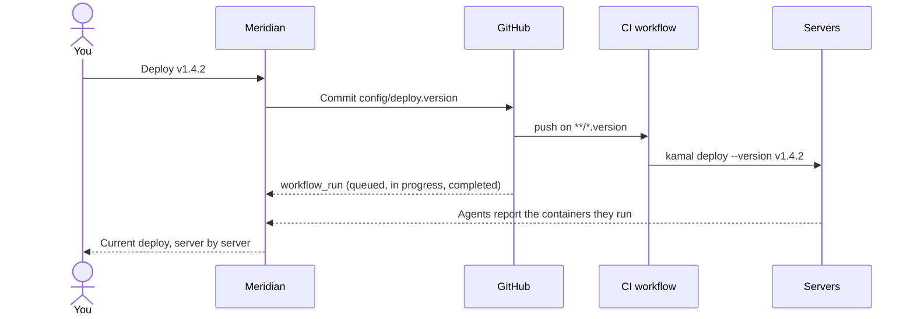

A deploy in Meridian is a commit. Meridian writes the new image tag to the app's version file in the infra repository, and the CI workflow runs `kamal deploy`. Meridian never connects to your servers. It watches the agents to see each server pick up the new version.



## Before you start

- You are a deployer or an admin. Viewers see the deploy panel without its form. See [Roles](/concepts/roles).
- The infra repository has the CI workflow, `.github/workflows/meridian-deploy.yml`. An admin adds it from the project page with **Add CI workflow**. See [Projects](/guides/projects#add-the-ci-workflow).
- The image tag already exists in your registry. The workflow runs `kamal deploy --skip-push`, so it never builds or pushes an image. Your source repository's CI does that.
- The servers run the agent, if you want to watch progress per server. See [Install the agent](/guides/agent).

## Deploy a version

<Steps>
  <Step title="Open the app">
    Open **Apps** and pick the app, or click the app's name on the board.
  </Step>
  <Step title="Type the version">
    Under **Ship a version**, type the image tag in **Version**. The field suggests the versions of the last 20 releases, and its placeholder is the newest one. A past release goes back to that version. A new tag ships new code.
  </Step>
  <Step title="Deploy">
    Click **Deploy** and confirm `Commit this version to config/deploy.version?`. Meridian commits the tag and says `Committed. CI will deploy it.`
  </Step>
  <Step title="Watch it roll out">
    **Current deploy** shows the CI run's state and one row per server. A row turns to `✓ Running v1.4.2` when that server's agent reports the new version running.
  </Step>
</Steps>

You can deploy from the board too. Click an app's name in the grid to open the side panel, type a tag under **Ship a version**, and click **Deploy**. **Open app page** takes you to the full page.

<Frame>
  
  
</Frame>

### What Meridian commits

The version file sits next to the app's Kamal config. It holds one line, the tag, and a newline.

| Config | Destination | Version file |
| --- | --- | --- |
| `config/deploy.yml` | none | `config/deploy.version` |
| `config/deploy.yml` | `staging` | `config/deploy.staging.version` |
| `deploy/shop.yml` | `production` | `deploy/shop.production.version` |

The first deploy creates the file. Until one exists, the board can't compare versions, and the app's cells show **Unknown**. See [Versions and releases](/concepts/versions-and-releases).

Meridian commits straight to the project's branch, never through a pull request. The commit message names the service, the destination when there is one, the version, and who asked:

```text Deploy commit
deploy(shop-production): v1.4.2

Meridian-Actor: Ada Lovelace <ada@example.com>
```

The push matches the workflow's `**/*.version` filter, so CI starts a run with one Kamal job for each version file the push changed. Jobs for one config and destination go one at a time. Jobs for different apps never wait on each other. See [CI workflow](/reference/ci-workflow).

### Version format

A version is a Docker image tag. It starts with a letter, a digit or `_`, then has up to 127 more letters, digits, `_`, `.` or `-`. Kamal names containers after it, and CI passes it as `--version`, so it can't start with `-`.

| Version | Accepted |
| --- | --- |
| `v1.4.2` | Yes |
| `3f2a9c1e` | Yes |
| `2026-11-26.1` | Yes |
| `-rc1` | No, it starts with `-` |
| `.hidden` | No, it starts with `.` |
| `1.0+build` | No, `+` isn't allowed |

### When Meridian refuses

| Message | Why |
| --- | --- |
| `v1.4.2 is already in config/deploy.version. Use Redeploy to run it again.` | The commit would change nothing, so the workflow would never run. |
| `The version file changed in Git since this page loaded. ...` | Someone changed the file between Meridian reading it and writing it. Meridian re-reads the repository. Check the new state and try again. |
| `GitHub refused the commit: ...` | GitHub said no, often because of a branch protection rule or a missing permission. See [GitHub App](/reference/github-app). |
| `shop only runs accessories: start them with kamal accessory boot, not a deploy` | The config runs only accessories, such as a tunnel's connectors. Neither its page nor the board's side panel has a deploy form. |

## Redeploy the current version

**Redeploy** asks CI to run the deploy workflow again for the version in the version file. Meridian makes no commit. It dispatches the workflow with `command=deploy` and the app's config, destination and version. Use it after you rotate a secret, or after a run failed for a reason outside Git, such as a server that was down.

<Steps>
  <Step title="Find the button">
    On the app page, **Redeploy** is under **Ship a version**. The board's side panel has **Redeploy** too. The button appears only when the app has a version file and at least one release.
  </Step>
  <Step title="Confirm">
    Confirm `Run the deploy workflow again for the version in config/deploy.version? Use this after rotating a secret.`. Meridian says `Asked CI to deploy v1.4.2 again.`
  </Step>
</Steps>

Meridian reads the version file when you click, not from its last sync. A version that landed a moment ago is never replaced by the one before it. An app without a version file can't be redeployed: `shop has no version file yet: deploy a version first`.

## Roll back

**Roll back** reverts the newest release. Meridian reads the version file as it was just before that release's commit, and commits that value back.

<Steps>
  <Step title="Find the newest release">
    On the app page, the newest entry under **Releases** carries the `newest` badge and a **Roll back** button. The board's side panel has **Roll back** too, for the same release.
  </Step>
  <Step title="Confirm">
    Confirm `Revert 3f2a9c1 so the version file goes back to its previous value? CI deploys the result.`. Meridian says `Committed a revert to v1.4.1. CI will deploy it.`
  </Step>
</Steps>

The commit says which commit it reverts:

```text Rollback commit
rollback(shop-production): v1.4.1

This reverts commit 3f2a9c1e5b7d...

Meridian-Actor: Ada Lovelace <ada@example.com>
```

**Roll back** shows only when the app has a version file and more than one release. Meridian checks two things before it commits:

- **The release is the newest one Meridian knows.** Otherwise it says `Only the newest release can be rolled back`.
- **Git agrees.** The newest commit that touched the version file must be that release's commit. If Git has moved on since the last sync, reverting would throw away the newer change, so Meridian refuses, re-reads the repository and asks you to check the new state.

If the version file didn't exist before the release, there is nothing to go back to: `Nothing to roll back to: ... Deploy a version instead.`

<Tip>
To go back further than one release, deploy the older version by name. The **Version** field suggests the last 20. Roll back a rollback, and you return to where you were. The rollback commit is now the newest release, and reverting it restores the version before it.
</Tip>

## Follow a deploy

**Current deploy** on the app page shows the newest deploy Meridian knows:

- A heading such as **Deploy of** `v1.4.2`, **Rollback to** `v1.4.1` or **Redeploy of** `v1.4.2`.
- Who asked, or **Git** when someone changed the version file outside Meridian. Their push still runs the workflow, and Meridian tracks that run like its own.
- The commit, and a **CI run** link once GitHub reports a run.
- One row per server, with the versions its agent reports and a badge: `✓ Running v1.4.2` or `… Waiting`.

The badge follows the CI run through four statuses. GitHub reports them through `workflow_run` webhooks, and Meridian also polls the runs every 30 seconds, so a missed webhook only delays the update.

| Status | Means |
| --- | --- |
| Pending | Meridian made the commit. No CI run has been reported yet. |
| Queued | GitHub has queued the run. |
| In progress | The run has started. |
| Completed | The run finished. The badge shows its conclusion instead, such as **Success**, **Failure** or **Cancelled**. |

Progress per server comes from the agents, never from the CI run's steps. A server counts as done when its agent reports a running container at the new version. A server without an agent stays at `… Waiting`, even after CI succeeds. While a deploy is not completed, the map marks its servers' places as **Deploying**.

<Note>
A completed run with **Success** means Kamal finished. It doesn't mean every server runs the version. The rows say that, and the board's cells turn **In sync** once every container matches. See [Drift](/concepts/drift).
</Note>

## Rate limits

Each action allows a few requests a minute from one IP address. Past that, Meridian answers `429 Too Many Requests`.

| Action | Limit |
| --- | --- |
| Deploy | 10 a minute |
| Roll back | 10 a minute |
| Redeploy | 5 a minute |

## Troubleshooting

<AccordionGroup>
  <Accordion title="The deploy stays at Pending">
    No CI run has started for the commit. Check that the infra repository has `.github/workflows/meridian-deploy.yml` on its branch, that GitHub Actions is turned on, and that the push changed a file ending in `.version`. Open the commit's checks on GitHub to see whether a run started.
  </Accordion>
  <Accordion title="CI succeeded, but servers stay at Waiting">
    The agents don't report the new version. Either the server has no agent, the agent has gone quiet, or Kamal didn't start the new container there. Open the server's page to see what its agent last reported, and the CI run's log to see what Kamal did.
  </Accordion>
  <Accordion title="The run fails with an image that can't be found">
    The workflow never builds images. Push `<registry>/<image>:<version>` from the source repository's CI first, then deploy that tag.
  </Accordion>
  <Accordion title="GitHub refused the commit">
    The GitHub App, or the token Meridian uses, needs **Contents: Read and write** on the infra repository, and branch protection must let it push to the branch. See [GitHub App](/reference/github-app).
  </Accordion>
</AccordionGroup>

## Related

<Columns cols={2}>
  <Card title="Versions and releases" icon="tag" href="/concepts/versions-and-releases">
    How version files become releases.
  </Card>
  <Card title="CI workflow" icon="workflow" href="/reference/ci-workflow">
    The workflow's triggers, inputs and secrets.
  </Card>
  <Card title="Secrets" icon="key-round" href="/guides/secrets">
    Rotate a value, then redeploy.
  </Card>
  <Card title="Activity" icon="history" href="/guides/activity">
    Every deploy, rollback and redeploy, with who asked.
  </Card>
</Columns>
