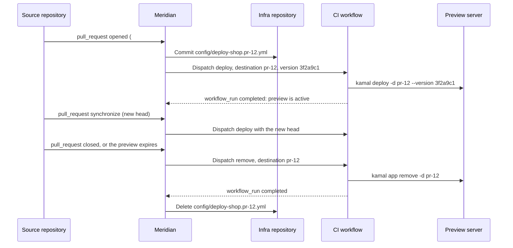

A [preview](/reference/glossary#preview) is a temporary copy of an app for one pull request, at its own hostname, such as `https://pr-12.shop.preview.example.com`. Meridian starts one when a pull request opens in the app's source repository. It removes it when the pull request closes.

## Before you start

You set these up once per app or per install.

<Steps>
  <Step title="Label the app with its source repository">
    The app's config names the repository it is built from:

    ```yaml
    labels:
      meridian.source: acme/shop
    ```

    Apps created with [New app](/guides/new-app) get this label. The app page shows it under **Configuration** as **Source**.
  </Step>
  <Step title="Send Meridian the source repository's pull request events">
    Install the GitHub App on the source repository, as well as the infra repository. Previews start from GitHub's `pull_request` [webhook](/reference/glossary#webhook), the message GitHub sends when a pull request changes. Meridian doesn't poll pull requests, so without the webhook nothing happens. See [GitHub App](/reference/github-app).
  </Step>
  <Step title="Set a preview domain">
    In **Settings**, under **Previews**, set **Domain**, such as `preview.example.com`. Without it, no preview starts.
  </Step>
  <Step title="Create wildcard DNS">
    Point a wildcard record at your preview servers, or at the tunnel or load balancer in front of them. Meridian doesn't manage DNS. The record depends on the hostname format. See [Hostnames](#hostnames).
  </Step>
  <Step title="Choose preview servers">
    In **Settings**, under **Previews**, set **Preview servers** to a label selector, such as `role=preview`. Meridian uses the matching server with the fewest containers. Leave it blank to use the least busy of the app's own servers.
  </Step>
  <Step title="Use Meridian's CI workflow">
    Use the workflow from **Add CI workflow**. If you change it, keep its `run-name`. Meridian finds preview runs by that name, `<command> <config> pr-<n>`. See [CI workflow](/reference/ci-workflow).
  </Step>
  <Step title="Push an image for every commit">
    The source repository's CI must push an image tagged with the full commit SHA, the commit's ID, such as `ghcr.io/acme/shop:3f2a9c1e...`. The deploy workflow never builds images.
  </Step>
</Steps>

<Warning>
For a preview, Kamal reads `.kamal/secrets-common` and `.kamal/secrets.pr-<n>`, never `.kamal/secrets`. Put the lines a preview needs, such as `KAMAL_REGISTRY_PASSWORD=$KAMAL_REGISTRY_PASSWORD`, in `.kamal/secrets-common`. See [Secrets](/guides/secrets#how-kamal-gets-the-values).
</Warning>

## What happens to a pull request

<Steps>
  <Step title="The pull request opens">
    Meridian picks a server and writes a small preview file next to the app's config, such as `config/deploy-shop.pr-12.yml`. It checks the file with Kamal and commits it to the infra repository.
  </Step>
  <Step title="CI deploys the head commit">
    Meridian asks GitHub to run the deploy workflow with `command=deploy`, `destination=pr-12` and `version=<head SHA>`, the pull request's newest commit. Each new push to the pull request deploys again. The preview file stays as it is.
  </Step>
  <Step title="The pull request closes, or the preview expires">
    Meridian asks GitHub to run the workflow with `command=remove`, and CI runs `kamal app remove -d pr-12`. That removes the preview's containers, images and proxy route. It leaves what the preview shares with the app: accessories, the registry login and kamal-proxy. Once the run succeeds, Meridian deletes the preview file.
  </Step>
</Steps>



<Accordion title="What the preview file holds">
  The file is a Kamal [destination](/reference/glossary#destination) file. Kamal reads destination files next to the config it is given. So `kamal deploy -c config/deploy-shop.yml -d pr-12` reads `config/deploy-shop.pr-12.yml`. For an app `shop` with a `web` role and a `job` role, pull request 12 gets:

  ```yaml config/deploy-shop.pr-12.yml
  # Preview of acme/shop#12. Generated by Meridian.
  # Removed when the pull request closes, or on 2026-12-03.
  service: shop
  servers:
    web:
    - preview-1.example.com
    job:
      cmd: bin/jobs
      hosts:
      - preview-1.example.com
  proxy:
    host: pr-12.shop.preview.example.com
  ```

  - **The app's own `service`.** Kamal only starts an image whose `service` label matches, and the preview runs the app's image. The `pr-<n>` destination keeps it apart from the real app. Its containers are `<app>-<role>-pr-<n>-<version>`, and its proxy route is `<app>-<role>-pr-<n>`.
  - **Every role on the preview server.** Each role keeps its own settings, such as `cmd`, `env` and `options`, from the base config and the app's destination file. A role's own proxy host becomes the preview hostname.
  - **The preview hostname**, on `proxy`.
  - **Everything else from the app's destination file**, if the app has one.

  Kamal merges this file onto the base config. So the rest, such as `image`, `registry` and `proxy.app_port`, comes from the app.
</Accordion>

## Hostnames

**Hostnames** in **Settings**, under **Previews**, picks one of two formats. A change applies only to new and reopened previews.

| Format | Example | Wildcard record |
| --- | --- | --- |
| Nested, the default: `pr-<n>.<app>.<domain>` | `pr-12.shop.preview.example.com` | One per app: `*.shop.preview.example.com` |
| Flat: `pr-<n>-<app>.<domain>` | `pr-12-shop.preview.example.com` | One for every app: `*.preview.example.com` |

Flat names sit one level below the domain, so Cloudflare's free certificate covers them. Use flat names behind a [Cloudflare Tunnel](/guides/cloudflare-tunnel#previews-behind-a-tunnel).

If the app uses `proxy.ssl: true`, [kamal-proxy](/reference/glossary#kamal-proxy) gets a certificate per hostname from Let's Encrypt. Then the names must resolve publicly.

<Accordion title="How the app's name becomes part of the hostname">
  `<app>` is the service name made safe for DNS. Meridian lowercases it and turns each run of other characters into `-`, so `my_app` becomes `my-app`. A name longer than 63 characters keeps its start and gets a short digest of the whole name. So two long names never end up the same.
</Accordion>

## The Previews page

**Previews** lists every preview that hasn't been removed, newest first. Each row shows the app, the pull request and its newest commit, the URL, the state, and when it expires. **Recently removed** lists the last 10 removed.

| State | Means |
| --- | --- |
| Deploying | Meridian started a deploy, and the run hasn't finished. |
| Active | The last deploy run succeeded. |
| Failed | The last deploy run failed, GitHub refused to start it, or a removal failed. |
| Removing | Meridian started a removal and is waiting for the run to succeed. |
| Removed | CI removed it, and the preview file is gone. |

A run that GitHub cancelled or skipped changes nothing. A deploy run that finishes after a removal started never brings the preview back.

### Remove a preview now

A deployer or an admin can click **Destroy** on a preview and confirm `Remove pr-12 from its server now?`. CI removes it as if the pull request had closed. The preview stays **Removing** until the run succeeds.

### Expiry

A preview expires after **Expire after (days)**, 7 by default, counted from when it was created. A push to the pull request doesn't extend it. A job checks every hour and removes expired previews.

Reopen a pull request whose preview was removed, and it gets a new preview, with a new expiry date.

<Accordion title="Edge cases">
  - A push to an expired preview, or one being removed, brings it back for a whole new lifetime.
  - When a removal run never reports back, Meridian deletes the preview file anyway after a day.
  - A failed removal goes back to **Failed** and keeps its preview file, so **Destroy** and the hourly check can try again.
  - After three failed removals, the hourly check stops. The state reads **Removal failed, needs a hand**, and Activity records `preview.removal_failed`. Check the CI runs, then click **Destroy** again. Or remove the `<service>-<role>-pr-<n>-<version>` containers by hand.
</Accordion>

## Limits

- **No previews for forks.** A preview would run a stranger's code on your servers, with the app's secrets. A pull request from a fork gets no preview, and Activity records `preview.skipped`.
- **One preview per config and pull request.** A config with several destinations, such as `staging` and `production`, gets one preview. It uses the destination file of the first destination, in alphabetical order.
- **One server per preview.** Every role runs on the preview server.
- **Shared accessories.** Databases and other accessories are the base config's. To keep previews apart, give them their own through a destination file.
- **Shared secret values.** A preview reads the same repository secrets as the app.

## When the app leaves Git

If an app's config disappears from Git, CI can't remove its previews, because Kamal needs the base config to do it. So Meridian deletes each preview file itself, and Activity records `preview.abandoned`. The entry names the `pr-<n>` containers and their servers. Remove those containers by hand.

If GitHub refuses to delete a preview file, the entry says so. Remove the file by hand too. Meridian never reads a leftover preview file as a config of its own.

## Related

<Columns cols={2}>
  <Card title="Settings" icon="settings" href="/operate/settings">
    The preview domain, hostnames, servers and lifetime.
  </Card>
  <Card title="Cloudflare Tunnel" icon="cloud" href="/guides/cloudflare-tunnel">
    Previews behind a tunnel.
  </Card>
</Columns>
