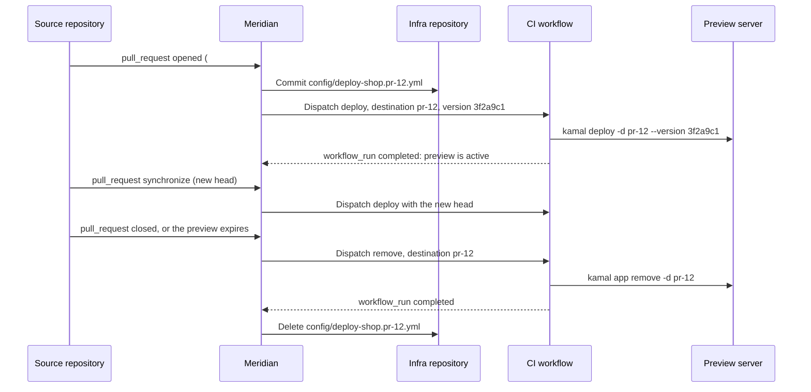

A pull request in an app's source repository can run as a Kamal destination named `pr-<n>`, at a hostname such as `https://pr-12.shop.preview.example.com`. Meridian writes a small destination file next to the app's config, and CI deploys the pull request's head commit with it. When the pull request closes, CI removes the preview and Meridian deletes the file.

## How a preview runs



<Steps>
  <Step title="The pull request opens">
    Meridian picks a server, writes the overlay `<config>.pr-<n>.yml`, checks it with Kamal, and commits it to the infra repository. Kamal reads destination files next to the config it is given, so `kamal deploy -c config/deploy-shop.yml -d pr-12` reads `config/deploy-shop.pr-12.yml`.
  </Step>
  <Step title="CI deploys the head commit">
    Meridian dispatches the workflow with `command=deploy`, `destination=pr-12` and `version=<head SHA>`. Each push to the pull request dispatches a new deploy of the new head. The overlay is written once and kept.
  </Step>
  <Step title="The pull request closes, or the preview expires">
    Meridian dispatches `command=remove`, and CI runs `kamal app remove -d pr-12`. That removes the preview's containers, images and proxy route. It leaves the accessories, the registry login and kamal-proxy, which the preview shares with the app. Once the run succeeds, Meridian deletes the overlay.
  </Step>
</Steps>

### What the overlay holds

For an app `shop` with a `web` role and a `job` role, pull request 12 gets:

```yaml config/deploy-shop.pr-12.yml
# Preview of acme/shop#12. Generated by Meridian.
# Removed when the pull request closes, or on 2026-12-03.
service: shop-pr-12
servers:
  web:
  - preview-1.example.com
  job:
    cmd: bin/jobs
    hosts:
    - preview-1.example.com
proxy:
  host: pr-12.shop.preview.example.com
```

- **`service: <app>-pr-<n>`**, so the preview's containers and proxy route never touch the real app.
- **Every role on one server**, the preview server. Each role keeps its own settings, such as `cmd`, `env` and `options`, from the base config and the app's destination file. A role's own proxy host becomes the preview hostname.
- **The preview hostname**, on `proxy`.
- **Everything else from the app's destination file**, if the app has one.

Kamal merges the overlay onto the base config, so the rest, such as `image`, `registry` and `proxy.app_port`, comes from the app.

## Requirements

<Steps>
  <Step title="Label the app with its source repository">
    The app's config names the repository it is built from:

    ```yaml
    labels:
      meridian.source: acme/shop
    ```

    Apps created with [New app](/guides/new-app) get this label. The app page shows it under **Configuration** as **Source**.
  </Step>
  <Step title="Send Meridian the source repository's pull request events">
    Previews start from GitHub's `pull_request` webhook. Meridian doesn't poll pull requests, so without the webhook nothing happens. Install the GitHub App on the source repository, as well as the infra repository. See [GitHub App](/reference/github-app).
  </Step>
  <Step title="Set a preview domain">
    In **Settings**, under **Previews**, set **Domain**, such as `preview.example.com`. Without it, no preview starts.
  </Step>
  <Step title="Create wildcard DNS">
    Point a wildcard record at your preview servers, or at the tunnel or load balancer in front of them. Meridian doesn't manage DNS. The record depends on the hostname format. See [Hostnames](#hostnames).
  </Step>
  <Step title="Choose preview servers">
    In **Settings**, under **Previews**, set **Preview servers** to a label selector, such as `role=preview`. Meridian uses the least busy matching server, the one with the fewest containers. Leave it blank to use the least busy of the app's own servers.
  </Step>
  <Step title="Use Meridian's CI workflow">
    Meridian matches preview runs by their name, `<command> <config> pr-<n>`. Use the workflow from **Add CI workflow**, or keep its `run-name` if you change it. See [CI workflow](/reference/ci-workflow).
  </Step>
  <Step title="Push an image for every commit">
    The source repository's CI must push an image tagged with the full commit SHA, such as `ghcr.io/acme/shop:3f2a9c1e...`. The workflow deploys with `--skip-push` and never builds.
  </Step>
</Steps>

<Warning>
Kamal reads `.kamal/secrets-common` and `.kamal/secrets.pr-<n>` for a preview, never `.kamal/secrets`. Put the lines a preview needs, such as `KAMAL_REGISTRY_PASSWORD=$KAMAL_REGISTRY_PASSWORD`, in `.kamal/secrets-common`. See [Secrets](/guides/secrets#how-kamal-gets-the-values).
</Warning>

## Hostnames

**Hostnames** in **Settings**, under **Previews**, chooses between two formats. A change applies to new and reopened previews only.

| Format | Example | Wildcard record |
| --- | --- | --- |
| Nested, the default: `pr-<n>.<app>.<domain>` | `pr-12.shop.preview.example.com` | One per app: `*.shop.preview.example.com` |
| Flat: `pr-<n>-<app>.<domain>` | `pr-12-shop.preview.example.com` | One for every app: `*.preview.example.com` |

`<app>` is the service name made into a DNS label. Meridian lowercases it and turns each run of other characters into `-`, so `my_app` becomes `my-app`. A label longer than 63 characters keeps its start and gets a short digest of the whole name, so two long names never end up the same.

Flat names sit one level below the domain, so Cloudflare's free certificate covers them. Use flat names behind a [Cloudflare Tunnel](/guides/cloudflare-tunnel#previews-behind-a-tunnel).

If the app uses `proxy.ssl: true`, kamal-proxy gets a certificate per hostname from Let's Encrypt, so the names must resolve publicly.

## The Previews page

**Previews** lists every preview that hasn't been removed, newest first, with its app, pull request and head commit, URL, state, and when it expires. Below that, **Recently removed** lists the last 10 removed.

| State | Means |
| --- | --- |
| Deploying | Meridian dispatched a deploy, and the run hasn't finished. |
| Active | The last deploy run succeeded. |
| Failed | The last deploy run failed, or GitHub refused the dispatch, or a removal failed. |
| Removing | Meridian dispatched a removal and is waiting for the run to succeed. |
| Removed | CI removed it, and the overlay is gone. |

A run GitHub cancelled or skipped changes nothing. A deploy run that finishes after a removal started never brings the preview back.

### Remove a preview now

A deployer or an admin can click **Destroy** on a preview and confirm `Remove pr-12 from its server now?`. Meridian dispatches the removal, as when the pull request closes. The preview stays **Removing** until the run succeeds.

### Expiry

A preview expires after **Expire after (days)**, 7 by default, counted from when it was created. A push to the pull request doesn't extend it, unless the preview has already expired or is being removed. Then the push brings it back for a whole new lifetime.

A job checks every hour and asks CI to remove expired previews. When a removal's run never reports back, Meridian deletes the overlay anyway after a day.

A failed removal goes back to **Failed**, with its overlay kept, so **Destroy** and the hourly check can ask again. After three failed removals, the hourly check stops asking, and Activity records `preview.removal_failed`. Check the CI runs, then click **Destroy** again, or remove the `<service>-pr-<n>` containers by hand.

Reopen a pull request whose preview was removed, and it gets a new preview, with a new overlay and a new expiry date.

## Limits

- **No previews for forks.** A fork's code is anyone's code, and a preview would run it on your servers with the app's secrets. A pull request from a fork gets no preview, and Activity records `preview.skipped` when it opens.
- **One preview per config and pull request.** A config with several destinations, such as `staging` and `production`, gets one preview, because all of them would write the same `<config>.pr-<n>.yml`. It inherits the destination file of the first destination, in alphabetical order.
- **One server per preview.** Every role runs on the preview server.
- **Shared accessories.** Databases and other accessories are the base config's. Give previews their own through a destination file if you need them apart.
- **Shared secret values.** A preview reads the same repository secrets as the app.

## When the app leaves Git

When a sync finds an app's config gone, CI can't remove its previews any more, because Kamal needs the base config to remove a destination. So Meridian deletes each preview's overlay itself, and Activity records `preview.abandoned`, naming the `<service>-pr-<n>` containers and the servers they run on. Remove those containers by hand. If GitHub refuses to delete an overlay, the entry says so, and you remove the file too. A leftover overlay is never read as a config of its own.

## Related

<Columns cols={2}>
  <Card title="Settings" icon="settings" href="/operate/settings">
    The preview domain, hostnames, servers and lifetime.
  </Card>
  <Card title="Cloudflare Tunnel" icon="cloud" href="/guides/cloudflare-tunnel">
    Previews behind a tunnel.
  </Card>
</Columns>
