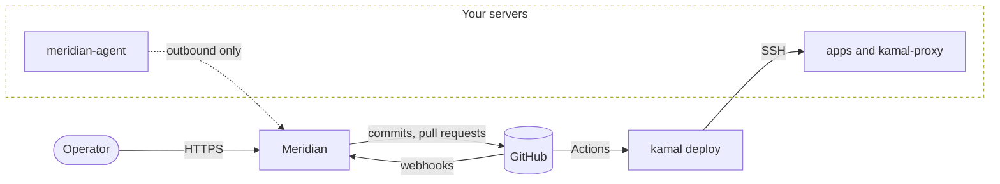

  

    
Open source · MIT licence · v0.1.0

    <h1 className="mt-4 text-5xl lg:text-6xl font-bold tracking-tight text-gray-900 dark:text-gray-50">Meridian</h1>
    
An open-source control room for <a href="https://kamal-deploy.org" className="underline decoration-primary/40 underline-offset-4">Kamal</a>. See every app on every server, deploy, roll back, add apps and preview pull requests.

    
A meridian is the line navigators measure every position against. Here that line is Git.

    

      <a href="/quickstart" className="inline-flex items-center rounded-full bg-primary dark:bg-primary-light px-5 py-2.5 text-sm font-semibold text-white dark:text-gray-950 no-underline">Try it in two minutes</a>
      <a href="/install" className="inline-flex items-center rounded-full border border-gray-300 dark:border-gray-700 px-5 py-2.5 text-sm font-semibold text-gray-900 dark:text-gray-100 no-underline">Install for real</a>
    

  

  

    <Frame caption="The board: what needs attention first, in plain sentences, then every app on every server.">
      
      
    </Frame>
  

  

    <h2 className="text-3xl font-bold tracking-tight text-gray-900 dark:text-gray-50">What it does</h2>
    
Meridian reads your Kamal configs from Git, and a small agent on each server reports what runs there. The board shows where the two disagree. Deploys, rollbacks and new apps are commits or pull requests, and your CI runs Kamal.

  

  

    <Columns cols={3}>
      <Card title="See the fleet" icon="table" href="/guides/board-and-map">
        Every app on every server, in sync, drifted, missing, stray, stale or unknown. A map of where it all runs.
      </Card>
      <Card title="Deploy and roll back" icon="rocket" href="/guides/deploy">
        Type a version and press Deploy. Meridian commits a one-line version file, and CI runs `kamal deploy`.
      </Card>
      <Card title="Add apps" icon="box" href="/guides/new-app">
        A form writes a Kamal config for a static, Node or Rails app, checks it with Kamal and opens a pull request.
      </Card>
      <Card title="Preview pull requests" icon="eye" href="/guides/previews">
        Each pull request in an app's repository runs as a `pr-<n>` Kamal destination, removed when it closes.
      </Card>
      <Card title="Set secrets" icon="key" href="/guides/secrets">
        Names come from your configs. Values go straight to GitHub Actions secrets and are never kept.
      </Card>
      <Card title="Watch it live" icon="gauge" href="/guides/live-stats-and-logs">
        CPU, memory, logs and requests from each server, streamed while you look.
      </Card>
    </Columns>
  

  

    <h2 className="text-3xl font-bold tracking-tight text-gray-900 dark:text-gray-50">How it works</h2>
    
Meridian writes only to GitHub. GitHub Actions runs Kamal, and Kamal reaches your servers over SSH. The agent on each server only ever connects out to Meridian, so Meridian needs no way in.

  

  

  

  
<a href="/concepts/how-it-works" className="font-semibold text-primary dark:text-primary-light">Read how Meridian works</a>, from a sync to a finished deploy.

  

    <h2 className="text-3xl font-bold tracking-tight text-gray-900 dark:text-gray-50">Principles</h2>
    
Seven rules decide what Meridian does and, more often, what it refuses to do.

  

  

    <Columns cols={2}>
      <Card title="1. Git is the record" icon="history">
        Every change Meridian makes to your configs and versions is a commit or a pull request to your infra repository. Uninstall Meridian and Git still holds every config, version and deploy.
      </Card>
      <Card title="2. One deploy path" icon="route">
        Meridian commits, and CI runs Kamal. Deploy status comes from CI.
      </Card>
      <Card title="3. Observe servers, never change them" icon="eye">
        A read-only agent on each server reaches out to Meridian. Meridian never connects in.
      </Card>
      <Card title="4. Secrets are write-only" icon="lock">
        Meridian stores secret names. Values go straight to GitHub and are never kept.
      </Card>
      <Card title="5. Generic" icon="globe">
        No assumptions about providers, networks or hostnames.
      </Card>
      <Card title="6. Scale is a feature" icon="server">
        Built for 500 servers and 200 apps from day one.
      </Card>
      <Card title="7. The Rails way" icon="gem">
        Rails 8, Hotwire, SQLite, no Node, no build step, one container.
      </Card>
      <Card title="The decisions behind them" icon="book-open" href="https://github.com/bigint/meridian/blob/main/contributing/decisions.md">
        Every choice made where the spec was ambiguous, and why.
      </Card>
    </Columns>
  

  

    <h2 className="text-3xl font-bold tracking-tight text-gray-900 dark:text-gray-50">Where next</h2>
  

  

    <Columns cols={3}>
      <Card title="Quickstart" icon="rocket" href="/quickstart">
        Run Meridian in Docker with a demo fleet of 500 servers.
      </Card>
      <Card title="Install" icon="download" href="/install">
        Connect GitHub, deploy with Kamal, add your infra repository.
      </Card>
      <Card title="Tour" icon="compass" href="/tour">
        Every screen, what it shows and what you can do there.
      </Card>
      <Card title="Drift" icon="split" href="/concepts/drift">
        The six states and the exact rule behind each one.
      </Card>
      <Card title="Install the agent" icon="radio" href="/guides/agent">
        Two Kamal accessories, a token and one network.
      </Card>
      <Card title="Reference" icon="list" href="/reference/environment">
        Every setting, endpoint, file format and command.
      </Card>
    </Columns>
  

