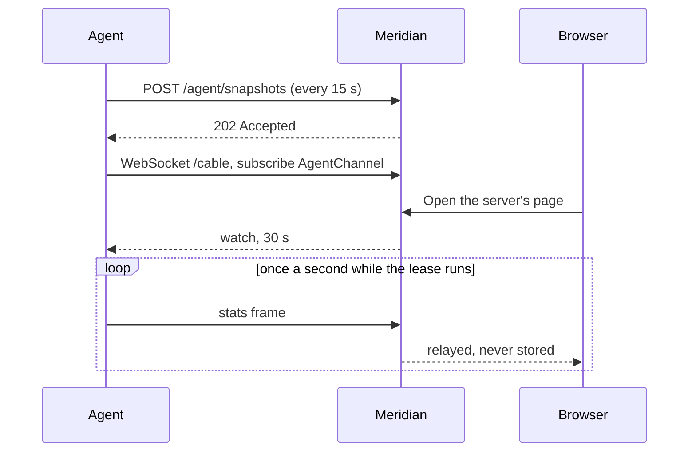

The agent talks to Meridian over two outbound connections. Meridian never connects to a server.

- **Snapshots:** `POST /agent/snapshots`, every 15 seconds or so. They say what runs on the server. Snapshots are the only way a server's record changes.
- **The live line:** one WebSocket to `/cable`, held open. It carries live stats, logs and traffic, and only while someone in Meridian is looking.

Both use the same agent token. For setup, see [Install the agent](/guides/agent). For the code, see `agent/README.md`.



## Snapshots

```http
POST /agent/snapshots HTTP/1.1
Authorization: Bearer meridian_…
Content-Type: application/json
User-Agent: meridian-agent/0.1.0
```

```json
{
  "agent_version": "0.1.0",
  "machine_id": "0123456789abcdef0123456789abcdef",
  "hostname": "app-1",
  "interval_seconds": 15,
  "labels": { "region": "sgp", "provider": "ovh" },
  "containers": [
    {
      "id": "a1a1…",
      "name": "web-web-production-3f2a9c1e",
      "image": "registry.example.com/acme/web:3f2a9c1e",
      "service": "web",
      "role": "web",
      "destination": "production",
      "version": "3f2a9c1e",
      "kind": "app",
      "state": "running",
      "health": "healthy",
      "started_at": "2026-11-25T10:00:00.123456789Z"
    }
  ]
}
```

### Fields

<ResponseField name="agent_version" type="string">
  The agent's build version. Kept up to 64 characters and shown on the server's page.
</ResponseField>

<ResponseField name="machine_id" type="string" required>
  The host's stable ID, from `MERIDIAN_MACHINE_ID` or `/etc/machine-id`. Kept up to 128 characters.
</ResponseField>

<ResponseField name="hostname" type="string" required>
  The host's name. It must be a plain host name: letters, digits, `.`, `_`, `:` and `-`, starting with a letter or digit, up to 253 characters. New app writes it into Kamal configs, where ERB would run.
</ResponseField>

<ResponseField name="interval_seconds" type="integer">
  `MERIDIAN_INTERVAL` in whole seconds, before jitter, from 1 to 86400. A server turns stale after three intervals, and never sooner than 45 seconds. Older agents leave it out, and Meridian assumes 15.
</ResponseField>

<ResponseField name="labels" type="object">
  `MERIDIAN_LABELS` as an object. Meridian keeps the first 32, with keys up to 64 characters and values up to 128. `lat` and `lng` (or `latitude`, `lon`, `longitude`) place the server on the map.
</ResponseField>

<ResponseField name="containers" type="array" required>
  Every Kamal container on the host, running or not, sorted by name. At most 2,000. Every key is always present, and unknown values are `""`.

  <Expandable title="container fields">
    <ResponseField name="id" type="string">The full container ID.</ResponseField>
    <ResponseField name="name" type="string">The container name.</ResponseField>
    <ResponseField name="image" type="string">The image reference.</ResponseField>
    <ResponseField name="service" type="string">Kamal's `service` label.</ResponseField>
    <ResponseField name="role" type="string">Kamal's `role` label.</ResponseField>
    <ResponseField name="destination" type="string">Kamal's `destination` label.</ResponseField>
    <ResponseField name="version" type="string">The container name minus `<service>-<role>[-<destination>]-`. Empty for accessories and kamal-proxy.</ResponseField>
    <ResponseField name="kind" type="string">`app`, `accessory` or `proxy`.</ResponseField>
    <ResponseField name="state" type="string">Docker's state: `created`, `running`, `paused`, `restarting`, `removing`, `exited` or `dead`.</ResponseField>
    <ResponseField name="health" type="string">Docker's health status. Empty without a healthcheck.</ResponseField>
    <ResponseField name="started_at" type="string">When the container started, RFC 3339. Empty if it never started.</ResponseField>
  </Expandable>
</ResponseField>

<ResponseField name="truncated" type="boolean">
  Present, and `true`, only when the snapshot went over 1 MiB and the agent dropped containers from the end to fit. Meridian then keeps containers it no longer sees instead of deleting them.
</ResponseField>

The agent recognises containers the way Kamal 2.12.0 names them:

| Kind | Recognised by |
| --- | --- |
| `app` | `service` and `role` labels, plus `destination` when there is one |
| `accessory` | A `service` label and no `role` label. Kamal names it `<service>-<accessory>`. |
| `proxy` | The container named `kamal-proxy` |

Every other container is ignored and never inspected.

### How a snapshot finds its server

Meridian answers at once and ingests the snapshot in a job. The job finds the server in this order:

1. The server a per-server token is already bound to.
2. The server with the same machine ID.
3. A server that no agent has claimed yet, or one Git lists whose agent has been silent for 10 minutes or more, whose host name or name equals `hostname`. Failing that, the one unclaimed server whose first DNS label matches. IP addresses must match whole. A rebuilt machine has a new machine ID and claims its old server this way.
4. A new server, named after `hostname`.

A per-server token binds to the first server it reports for. A fleet token never binds, and each machine ID is its own server.

### Responses

| Status | When | Body |
| --- | --- | --- |
| `202 Accepted` | The snapshot is valid and queued. | Empty |
| `400 Bad Request` | The body is not JSON. | `{"errors":["Body must be JSON"]}` |
| `401 Unauthorized` | The token is missing, unknown or revoked. | Empty |
| `413 Content Too Large` | `Content-Length` is over 1 MiB. Checked before the token. | Empty |
| `422 Unprocessable Content` | The snapshot breaks a rule above, or a per-server token is used on a second machine. | `{"errors":[…]}`, with each reason |
| `429 Too Many Requests` | The token sent more than 120 snapshots in a minute, or a fleet token went over its limits. | Empty, with `Retry-After: 60` |

A per-server token used on a second machine gets `422` with `This token belongs to another server. Give each server its own token, or use a fleet token`. Once that server has been silent for 10 minutes or more, the new machine takes it over instead.

### Rate limit and backoff

Meridian allows 120 snapshots a minute per token. For a fleet token the limit is per token and machine ID, so every server on it gets its own 120, and the whole token may send 12,000 a minute. At the default interval an agent sends four a minute.

The agent counts any `2xx` as delivered. On any other answer, or no answer:

- The next try waits the interval doubled once per consecutive failure, up to 5 minutes, with ±20% jitter.
- After a `429` it waits at least `Retry-After`, in seconds or as an HTTP date, jittered up to 20% later so a fleet told the same wait does not return at once, and never more than 5 minutes.
- The first success resets the delay to the interval.

Docker calls time out after 10 seconds, the POST after 15 and a whole cycle after 30. The first snapshot goes out at start.

## The live line

The agent opens one WebSocket to `$MERIDIAN_URL/cable`, Rails' Action Cable, and keeps it open. `https://` means TLS. It speaks the `actioncable-v1-json` subprotocol, with these headers on the upgrade:

```http
GET /cable HTTP/1.1
Authorization: Bearer meridian_…
Origin: https://meridian.example.com
Sec-WebSocket-Protocol: actioncable-v1-json
User-Agent: meridian-agent/0.1.0
```

A connection with an `Authorization` header is an agent and nothing else. It never falls back to a session cookie. An unknown or revoked token is refused.

After Action Cable's `welcome`, the agent subscribes:

```json
{"channel":"AgentChannel","machine_id":"0123456789abcdef0123456789abcdef"}
```

Meridian rejects the subscription until the server exists, which takes a first snapshot. A per-server token must also be bound to the server with that machine ID. Snapshots stay the only thing that creates or changes a server.

| Event | What the agent does |
| --- | --- |
| A rejected subscription, a dropped connection or a failed upgrade | Retries after 5 seconds, doubling to 60, with ±20% jitter. A confirmed subscription resets the delay. |
| No frame for 10 seconds | Closes the line and reconnects. Action Cable pings every 3 seconds. |
| `401` or `403` on the upgrade, or `{"type":"disconnect","reason":"unauthorized","reconnect":false}` | Logs it and waits 5 minutes. |

Meridian checks the token again every 60 seconds, and revoking a token hangs up its open lines at once. Inbound messages are capped at 1 MiB.

### Leases

Meridian sends leases inside the Action Cable message envelope. Nothing streams outside a lease. The agent keeps `until = max(until, now + min(seconds, 120))` for each, so the two hosts' clocks never need to agree.

<ResponseField name="watch" type="lease">
  ```json
  {"type":"watch","seconds":30}
  ```

  Someone has the server's page open. Each open page renews it every 10 seconds, and Meridian sends at most one renewal per server every 5 seconds, however many people watch. A page that has been silent for 75 seconds, such as a laptop asleep, stops renewing.
</ResponseField>

<ResponseField name="tail" type="lease">
  ```json
  {"type":"tail","container":"<64-hex id>","seconds":30,"backlog":200}
  ```

  A deployer is reading this container's logs, or an app's traffic through kamal-proxy. A new reader asks for `backlog: 200` recent lines. Renewals, every 10 seconds, send `backlog: 0`. The agent accepts a backlog of up to 1,000.
</ResponseField>

When an agent subscribes, Meridian sends it the watch lease still running and a `tail` with `backlog: 200` for each container someone is still reading. Leases sent while the agent was away are lost otherwise. Messages of any other type are ignored.

### Frames the agent sends

The agent sends frames as Action Cable commands, and only while the line is subscribed. A frame that can't go out is dropped, never queued.

```json
{"command":"message","identifier":"<the subscription identifier>","data":"<the frame, as a JSON string>"}
```

<ResponseField name="stats" type="frame">
  Once a second during a watch lease: host CPU, memory, load and disk, and each running Kamal container's CPU, memory, network and disk rates. Sizes are bytes, rates are bytes per second, and `cpu_cores` is cores busy, so `2.0` is two cores flat out.

  ```json
  {
    "action": "stats",
    "host": { "cpu_cores": 0.21, "cores": 2, "memory_used": 71303168, "memory_total": 2147483648, "load1": 0.05, "disk_used": 9663676416, "disk_total": 42949672960 },
    "containers": [
      { "id": "<64-hex id>", "cpu_cores": 0.003, "memory_used": 3596288, "memory_limit": 2147483648, "net_rx": 14.7, "net_tx": 211.3, "disk_read": 0, "disk_write": 0 }
    ]
  }
  ```

  `host` is left out when `/host/proc` is not mounted.
</ResponseField>

<ResponseField name="logs" type="frame">
  A batch of log lines from one container, during its tail lease, when the agent runs with `MERIDIAN_LOGS=1`.

  ```json
  {
    "action": "logs",
    "container": "<64-hex id>",
    "backlog": false,
    "lines": [
      { "t": "2026-11-26T12:16:25.123456789Z", "s": "out", "m": "GET / 200 1.2ms" }
    ],
    "dropped": 0,
    "ended": false
  }
  ```

  - `t` is Docker's timestamp, `s` is `out` or `err`, and `m` is the line as UTF-8, cut to 8,192 bytes with a trailing `…`.
  - `backlog: true` marks history lines. History and live lines never share a batch.
  - `dropped` counts lines over the rate limit since the last batch.
  - `ended: true` comes once, when the container has stopped.
  - With logs off, the agent answers a tail with `{"action":"logs","container":"<id>","off":true}`. For a container it won't follow, it sends `"refused":"<short reason>"`.
</ResponseField>

### Limits

| Limit | Where | Value |
| --- | --- | --- |
| Stats frames relayed | Meridian | One per 0.5 seconds per agent. Faster frames are dropped. |
| Containers per stats frame | Both | 500 |
| Containers tailed at once | Agent | 20 |
| Batches per container | Agent | One per 250 ms, at most 500 lines and 256 KiB of text |
| Log rate per container | Agent | 512 KiB a second, counting each line's text plus 64 bytes |
| Line length | Agent | 8,192 bytes |
| Backlog | Agent | 1,000 lines |
| Log frames accepted | Meridian | 100 a second per agent. Past that, frames are dropped. |
| Lines per batch kept | Meridian | 1,000 |
| Containers per logs page | Meridian | 20 |

### What Meridian does with frames

Meridian keeps only the keys above, as finite, non-negative numbers for stats, and relays them to the browsers reading. Nothing is stored. Log lines pass through the Solid Cable database, which keeps messages for one minute.

- A log batch reaches readers only if its container is placed on the agent's own server.
- A kamal-proxy batch also feeds **Traffic**. Meridian reads kamal-proxy's JSON request lines, those with `"msg":"Request"`, and sends each one only to the readers of the app whose service logged it. Every other line stops there.

## What the agent never sends

- Environment variables, commands, entrypoints, mounts or binds. The agent decodes only the fields listed on this page and discards the rest of Docker's response while it parses it. A test checks this against fixtures full of secrets.
- Anything about containers that aren't Kamal's.
- Logs, unless it runs with `MERIDIAN_LOGS=1` and a deployer is reading them. The agent writes them to no file and keeps none.
- Docker API calls through `HTTP_PROXY`, even when one is set to reach Meridian.

The agent calls only these Docker endpoints: `GET /containers/json?all=1`, `GET /containers/{id}/json`, `GET /containers/{id}/stats?stream=true` during a watch, and `GET /containers/{id}/logs` during a tail. It starts, stops and changes nothing.
