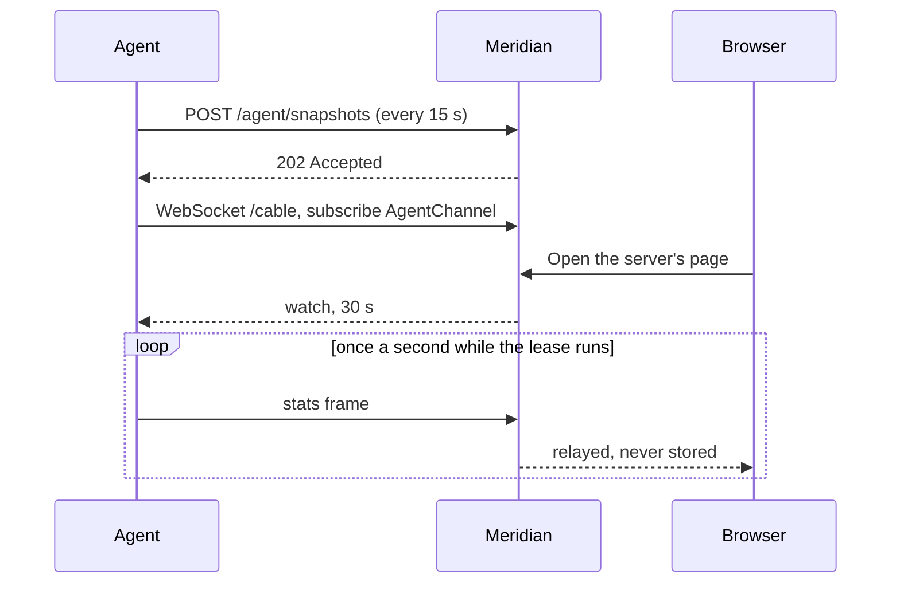

This page describes exactly what the [agent](/reference/glossary#agent) sends Meridian, and how Meridian answers. The agent is a small program on each server that tells Meridian what is running there.

The agent opens two connections out to Meridian. Meridian never connects to a server.

- **Snapshots:** `POST /agent/snapshots`, about every 15 seconds. Each one says what runs on the server. Snapshots are the only way a server's record in Meridian changes.
- **The live line:** one WebSocket to `/cable` that stays open. It carries live stats, logs and traffic, and only while someone in Meridian is looking.

Both use the same agent token. For setup, see [Install the agent](/guides/agent). For the code, see `agent/README.md`.



## Snapshots

A snapshot is what one agent saw on one server at one moment. The agent sends it as a JSON request:

```http
POST /agent/snapshots HTTP/1.1
Authorization: Bearer meridian_…
Content-Type: application/json
User-Agent: meridian-agent/0.1.0
```

```json
{
  "agent_version": "0.1.0",
  "machine_id": "0123456789abcdef0123456789abcdef",
  "hostname": "app-1",
  "interval_seconds": 15,
  "labels": { "region": "sgp", "provider": "ovh" },
  "containers": [
    {
      "id": "a1a1…",
      "name": "web-web-production-3f2a9c1e",
      "image": "registry.example.com/acme/web:3f2a9c1e",
      "service": "web",
      "role": "web",
      "destination": "production",
      "version": "3f2a9c1e",
      "kind": "app",
      "state": "running",
      "health": "healthy",
      "started_at": "2026-11-25T10:00:00.123456789Z"
    }
  ]
}
```

### Fields

<ResponseField name="agent_version" type="string">
  The agent's build version. Meridian keeps up to 64 characters and shows it on the server's page.
</ResponseField>

<ResponseField name="machine_id" type="string" required>
  The host's ID that never changes, from `MERIDIAN_MACHINE_ID` or `/etc/machine-id`. Meridian keeps up to 128 characters.
</ResponseField>

<ResponseField name="hostname" type="string" required>
  The host's name. It must be a plain host name of up to 253 characters: letters, digits, `.`, `_`, `:` and `-`. It must start with a letter or digit. **New app** writes it into Kamal configs, where any ERB code in it would run.
</ResponseField>

<ResponseField name="interval_seconds" type="integer">
  `MERIDIAN_INTERVAL` in whole seconds, from 1 to 86400, before the agent's random ±20% change. A server turns stale after three intervals, and never sooner than 45 seconds. If this field is missing, Meridian assumes 15.
</ResponseField>

<ResponseField name="labels" type="object">
  `MERIDIAN_LABELS` as an object. Meridian keeps the first 32, with keys up to 64 characters and values up to 128. `lat` and `lng` (or `latitude`, `lon`, `longitude`) place the server on the map.
</ResponseField>

<ResponseField name="containers" type="array" required>
  Every Kamal container on the host, running or not, sorted by name, up to 2,000. Every key is always present, and unknown values are `""`.

  <Expandable title="container fields">
    <ResponseField name="id" type="string">The full container ID.</ResponseField>
    <ResponseField name="name" type="string">The container name.</ResponseField>
    <ResponseField name="image" type="string">The image reference.</ResponseField>
    <ResponseField name="service" type="string">Kamal's `service` label.</ResponseField>
    <ResponseField name="role" type="string">Kamal's `role` label.</ResponseField>
    <ResponseField name="destination" type="string">Kamal's `destination` label.</ResponseField>
    <ResponseField name="version" type="string">The container name minus `<service>-<role>[-<destination>]-`. Empty for accessories and kamal-proxy.</ResponseField>
    <ResponseField name="kind" type="string">`app`, `accessory` or `proxy`.</ResponseField>
    <ResponseField name="state" type="string">Docker's state: `created`, `running`, `paused`, `restarting`, `removing`, `exited` or `dead`.</ResponseField>
    <ResponseField name="health" type="string">Docker's health status. Empty without a healthcheck.</ResponseField>
    <ResponseField name="started_at" type="string">When the container started, RFC 3339. Empty if it never started.</ResponseField>
  </Expandable>
</ResponseField>

<ResponseField name="truncated" type="boolean">
  Present, and `true`, only when the snapshot went over 1 MiB, so the agent dropped containers from the end to fit. Meridian then keeps the containers it no longer sees, instead of deleting them.
</ResponseField>

The agent recognises containers the way Kamal 2.12.0 names them:

| Kind | Recognised by |
| --- | --- |
| `app` | `service` and `role` labels, plus `destination` when there is one |
| `accessory` | A `service` label and no `role` label. Kamal names it `<service>-<accessory>`. |
| `proxy` | The container named `kamal-proxy` |

The agent ignores every other container and never inspects it.

### How a snapshot finds its server

Meridian answers at once, and saves the snapshot in a background job. The job finds the server in this order:

1. The server a per-server token already belongs to.
2. The server with the same machine ID.
3. A server whose host name or name equals `hostname`. It must be a server no agent has claimed yet, or one Git lists whose agent has been silent for 10 minutes or more.
4. The one unclaimed server whose first DNS label matches, such as `app-1` in `app-1.example.com`. IP addresses must match whole.
5. A new server, named after `hostname`.

A rebuilt machine has a new machine ID, and claims its old server by step 3.

A per-server token belongs to the first server it reports for. A fleet token never belongs to one server, and each machine ID is its own server.

### Responses

| Status | When | Body |
| --- | --- | --- |
| `202 Accepted` | The snapshot is valid and queued. | Empty |
| `400 Bad Request` | The body is not JSON. | `{"errors":["Body must be JSON"]}` |
| `401 Unauthorized` | The token is missing, unknown or revoked. | Empty |
| `413 Content Too Large` | `Content-Length` is over 1 MiB. Meridian checks this before the token. | Empty |
| `422 Unprocessable Content` | The snapshot breaks a rule above, or a per-server token is used on a second machine. | `{"errors":[…]}`, with each reason |
| `429 Too Many Requests` | The token sent more than 120 snapshots in a minute, or a fleet token went over its limits. | Empty, with `Retry-After: 60` |

A per-server token used on a second machine gets `422` with `This token belongs to another server. Give each server its own token, or use a fleet token`. Once that server has been silent for 10 minutes or more, the new machine takes it over instead.

### Rate limit and retries

Meridian allows 120 snapshots a minute per token. At the default interval, an agent sends four a minute.

For a fleet token, the limit is per token and machine ID. So every server on the token gets its own 120. The whole token can send 12,000 a minute.

The agent counts any `2xx` answer as delivered. On any other answer, or no answer, it waits longer before it tries again:

- Each failure in a row doubles the wait, starting from the interval, up to 5 minutes. The agent moves each wait by a random ±20%.
- After a `429`, it waits at least `Retry-After`, given in seconds or as an HTTP date, and never more than 5 minutes.
- It adds a random 0 to 20% to that `Retry-After` wait, so a fleet told the same wait doesn't come back all at once.
- The first success sets the wait back to the interval.

The agent sends its first snapshot when it starts. Docker calls time out after 10 seconds, the POST after 15, and a whole cycle after 30.

## The live line

The live line is one WebSocket from the agent to `$MERIDIAN_URL/cable`, which is Rails' Action Cable. The agent keeps it open. An `https://` URL means the line uses TLS.

The agent speaks the `actioncable-v1-json` subprotocol. It sends these headers when it opens the connection:

```http
GET /cable HTTP/1.1
Authorization: Bearer meridian_…
Origin: https://meridian.example.com
Sec-WebSocket-Protocol: actioncable-v1-json
User-Agent: meridian-agent/0.1.0
```

Meridian treats a connection with an `Authorization` header as an agent, and nothing else. It never falls back to a session cookie. Meridian refuses an unknown or revoked token.

After Action Cable's `welcome`, the agent subscribes:

```json
{"channel":"AgentChannel","machine_id":"0123456789abcdef0123456789abcdef"}
```

Meridian rejects the subscription until the server exists, so the agent must send a snapshot first. A per-server token must also belong to the server with that machine ID. Only snapshots create or change a server.

| Event | What the agent does |
| --- | --- |
| A rejected subscription, a dropped connection or a failed upgrade | Tries again after 5 seconds, doubling up to 60, moved by a random ±20%. A confirmed subscription resets the wait. |
| No frame for 10 seconds | Closes the line and reconnects. Action Cable pings every 3 seconds. |
| `401` or `403` on the upgrade, or `{"type":"disconnect","reason":"unauthorized","reconnect":false}` | Logs it and waits 5 minutes. |

Meridian checks the token again every 60 seconds. When you revoke a token, Meridian closes its open lines at once. Messages to Meridian can be at most 1 MiB.

### Leases

A lease is a short request from Meridian to send data for a few seconds. The agent streams nothing without one. Meridian sends leases inside Action Cable messages.

For each lease, the agent keeps `until = max(until, now + min(seconds, 120))`. It counts on its own clock, so the two hosts' clocks never need to agree.

<ResponseField name="watch" type="lease">
  ```json
  {"type":"watch","seconds":30}
  ```

  Someone has the server's page open. Each open page renews the lease every 10 seconds. Meridian sends at most one renewal per server every 5 seconds, however many people watch. A page that has been silent for 75 seconds, such as on a sleeping laptop, stops renewing.
</ResponseField>

<ResponseField name="tail" type="lease">
  ```json
  {"type":"tail","container":"<64-hex id>","seconds":30,"backlog":200}
  ```

  A deployer is reading this container's logs, or an app's traffic through [kamal-proxy](/reference/glossary#kamal-proxy). A new reader asks for `backlog: 200` recent lines. Renewals come every 10 seconds, with `backlog: 0`. The agent accepts a backlog of up to 1,000.
</ResponseField>

When an agent subscribes, Meridian sends it any watch lease still running. It also sends a `tail` with `backlog: 200` for each container someone is still reading. Without this, the agent would miss leases sent while it was away. The agent ignores messages of any other type.

### Frames the agent sends

A frame is one message from the agent. The agent sends frames as Action Cable commands, and only while the line is subscribed. If a frame can't go out, the agent drops it and never queues it.

```json
{"command":"message","identifier":"<the subscription identifier>","data":"<the frame, as a JSON string>"}
```

<ResponseField name="stats" type="frame">
  Sent once a second during a watch lease. It holds the host's CPU, memory, load and disk, and each running Kamal container's CPU, memory, network and disk rates.

  Sizes are in bytes, and rates in bytes per second. `cpu_cores` is the number of cores busy, so `2.0` is two cores fully in use.

  ```json
  {
    "action": "stats",
    "host": { "cpu_cores": 0.21, "cores": 2, "memory_used": 71303168, "memory_total": 2147483648, "load1": 0.05, "disk_used": 9663676416, "disk_total": 42949672960 },
    "containers": [
      { "id": "<64-hex id>", "cpu_cores": 0.003, "memory_used": 3596288, "memory_limit": 2147483648, "net_rx": 14.7, "net_tx": 211.3, "disk_read": 0, "disk_write": 0 }
    ]
  }
  ```

  The agent leaves out `host` when `/host/proc` is not mounted.
</ResponseField>

<ResponseField name="logs" type="frame">
  A batch of log lines from one container, during its tail lease, when the agent runs with `MERIDIAN_LOGS=1`.

  ```json
  {
    "action": "logs",
    "container": "<64-hex id>",
    "backlog": false,
    "lines": [
      { "t": "2026-11-26T12:16:25.123456789Z", "s": "out", "m": "GET / 200 1.2ms" }
    ],
    "dropped": 0,
    "ended": false
  }
  ```

  - `t` is Docker's timestamp, and `s` is `out` or `err`.
  - `m` is the line as UTF-8, cut to 8,192 bytes with a trailing `…`.
  - `backlog: true` marks past lines. Past and live lines never share a batch.
  - `dropped` counts the lines over the rate limit since the last batch.
  - `ended: true` comes once, when the container has stopped.
  - With logs off, the agent answers a tail with `{"action":"logs","container":"<id>","off":true}`.
  - For a container it won't follow, the agent sends `"refused":"<short reason>"`.
</ResponseField>

### Limits

| Limit | Where | Value |
| --- | --- | --- |
| Stats frames passed on | Meridian | One per 0.5 seconds per agent. Meridian drops faster frames. |
| Containers per stats frame | Both | 500 |
| Containers tailed at once | Agent | 20 |
| Batches per container | Agent | One per 250 ms, at most 500 lines and 256 KiB of text |
| Log rate per container | Agent | 512 KiB a second, counting each line's text plus 64 bytes |
| Line length | Agent | 8,192 bytes |
| Backlog | Agent | 1,000 lines |
| Log frames accepted | Meridian | 100 a second per agent. Meridian drops frames past that. |
| Lines per batch kept | Meridian | 1,000 |
| Containers per logs page | Meridian | 20 |

### What Meridian does with frames

Meridian keeps only the keys above, and for stats only finite numbers of zero or more. It passes them on to the browsers that are reading, and stores nothing. Log lines pass through the Solid Cable database, which keeps messages for one minute.

- A log batch reaches readers only if its container is on the agent's own server.
- A kamal-proxy batch also feeds **Traffic**. Meridian reads kamal-proxy's JSON request lines, those with `"msg":"Request"`.
- Meridian sends each request line only to the readers of the app whose service logged it. Every other line stops there.

## What the agent never sends

- Environment variables, commands, entrypoints, mounts or binds. The agent decodes only the fields on this page, and throws away the rest of Docker's answer as it reads it. A test checks this against sample data full of secrets.
- Anything about containers that aren't Kamal's.
- Logs, unless it runs with `MERIDIAN_LOGS=1` and a deployer is reading them. The agent writes them to no file and keeps none.
- Docker API calls through `HTTP_PROXY`, even when one is set to reach Meridian.

The agent calls only these Docker endpoints, and starts, stops and changes nothing:

- `GET /containers/json?all=1`
- `GET /containers/{id}/json`
- `GET /containers/{id}/stats?stream=true`, during a watch
- `GET /containers/{id}/logs`, during a tail
