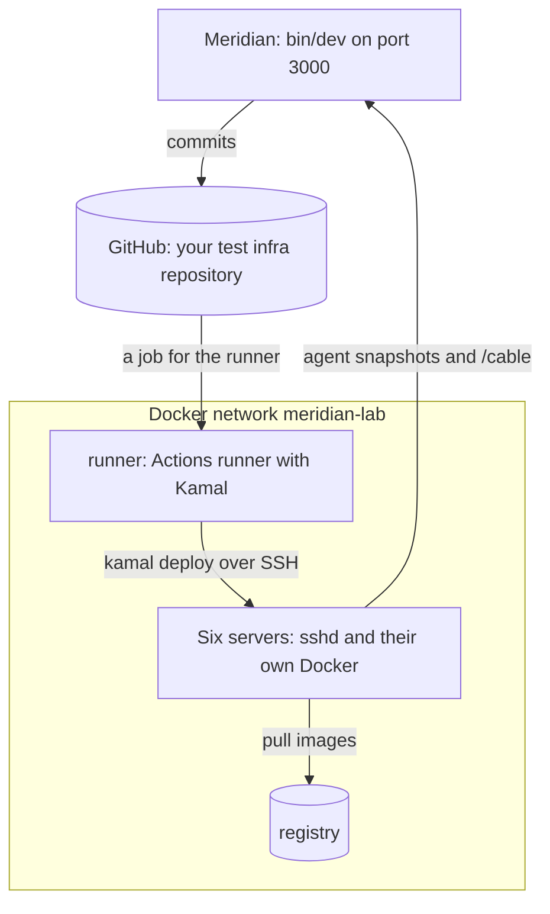

# Lab

The lab is a local fleet for trying Meridian against real Kamal deploys. It runs inside Docker (kiri, Docker Desktop, OrbStack or any other), and `bin/lab` drives it. Nothing in `lab/` is used in production.



## What runs in the lab

`lab/compose.yml` starts these containers on a Docker network called `meridian-lab`:

- **Six servers**, named like AWS availability zones. Each one is a `docker:27-dind` container that runs `sshd` and its own Docker daemon, so Kamal deploys to it exactly as it would to a VM. Each keeps a machine ID of its own and trusts the lab's SSH key.
- **`registry`**: a private image registry. It is `registry:5000` inside the lab and `localhost:5555` from your machine, with the user `lab` and a generated password.
- **`runner`**: a GitHub Actions self-hosted runner, registered on your test infra repository with the labels `self-hosted` and `meridian-lab`. It has Kamal `2.12.0` and sits on the lab network, so the Meridian deploy workflow can run `kamal deploy` against the servers.

The places are pretend, for the map. `bin/lab agents` reports them as the agent labels `region`, `city`, `lat` and `lng`, with `provider=lab`. They are set in `FLEET` at the top of `bin/lab`.

| Server | `region` | `city` | `lat`, `lng` |
| --- | --- | --- | --- |
| `aps2-az1-node-01` | `ap-south-2` | Bangalore | `12.97`, `77.59` |
| `aps2-az1-node-02` | `ap-south-2` | Bangalore | `12.98`, `77.6` |
| `apse1-az1-node-01` | `ap-southeast-1` | Singapore | `1.35`, `103.82` |
| `use1-az1-node-01` | `us-east-1` | New York | `40.71`, `-74.01` |
| `euc1-az1-node-01` | `eu-central-1` | Frankfurt | `50.11`, `8.68` |
| `apse2-az1-node-01` | `ap-southeast-2` | Sydney | `-33.87`, `151.21` |

### The apps

The lab deploys the six real bigint sites: `yoginth-com`, `asiafibernet-com`, `nailbykyro-com`, `asiagigafibernet-com`, `occasions` and `pckumar-in`. Each version is a public, files-only image at `ghcr.io/bigint/<site>:<commit>`. `bin/lab push` wraps it in nginx (`lab/site/`), the way `bigint/infra` serves it in production, and pushes it to the lab registry as `bigint/<site>:<7-character commit>`. The nginx image listens on port `3000` and answers `/up` for kamal-proxy.

Their Kamal configs live in `bigint/meridian-infra-test`, with the real hostnames. To try one, open a shell on a server and ask kamal-proxy for it:

```bash
bin/lab ssh use1-az1-node-01
curl -H 'Host: yoginth.com' http://localhost/
```

### Umami

The lab also runs Umami, a web analytics app, with its database split across regions. Postgres writes go to the primary in Bangalore (`aps2-az1-node-01`). A streaming replica in Singapore (`apse1-az1-node-01`) serves the Singapore server's reads through Umami's `DATABASE_REPLICA_URL`. Umami runs on the three tunnel servers, at `https://umami.yoginth.net`, through the Cloudflare Tunnel `meridian-lab`. See [Cloudflare Tunnel](../docs/guides/cloudflare-tunnel.mdx) for how such a tunnel is set up.

`bin/lab push umami VERSION` takes a release tag from `ghcr.io/umami-software/umami`, labels it for Kamal (`lab/umami/`) and pushes it to the lab registry.

## Before you start

- Docker, with room for six nested Docker daemons.
- The GitHub CLI, `gh`, signed in as someone who can administer the test infra repository. `bin/lab` uses it to register the runner and set secrets.
- `curl`, `jq`, `openssl` and `ssh-keygen`.
- A test infra repository you own, with configs like `bigint/meridian-infra-test`. In the commands below it is `owner/infra-repo`.
- Meridian running locally. See [Development](../contributing/development.md).

## Run a deploy end to end

### 1. Start Meridian

```bash
GITHUB_TOKEN=github_pat_… bin/dev
```

### 2. Start the lab

```bash
bin/lab up owner/infra-repo
```

This generates the lab's secrets, builds and starts the registry and the six servers, then registers the runner on `owner/infra-repo` and starts it.

### 3. Give the infra repository its secrets

```bash
bin/lab secrets owner/infra-repo
```

This sets `KAMAL_REGISTRY_PASSWORD`, `KAMAL_SSH_PRIVATE_KEY`, `UMAMI_POSTGRES_PASSWORD`, `UMAMI_REPLICATION_PASSWORD` and `UMAMI_APP_SECRET` as repository secrets, and `CLOUDFLARE_TUNNEL_TOKEN` if `lab/.secrets/cloudflare_tunnel_token` holds one. It sets only the ones the repository lacks, so it never replaces a secret set elsewhere.

### 4. Send the deploy workflow to the lab runner

The deploy workflow runs on `ubuntu-latest` unless the repository variable `MERIDIAN_RUNS_ON` names another runner. GitHub's runners can't reach the lab, so point it at the lab runner's label:

```bash
gh variable set MERIDIAN_RUNS_ON --body meridian-lab --repo owner/infra-repo
```

### 5. Push images to the lab registry

```bash
bin/lab push all
bin/lab versions occasions
bin/lab push occasions 6c45ebf
```

`push all` pushes the newest version of every site. `versions` lists a site's versions, oldest first. Push an older one to have something to deploy or roll back to.

### 6. Add the project in Meridian

Add `owner/infra-repo` on **Projects**, then press **Add CI workflow** on its page if the repository has no `.github/workflows/meridian-deploy.yml` yet. See [Projects](../docs/guides/projects.mdx).

### 7. Start the agents

```bash
bin/lab agents
```

This builds `meridian-agent` from `agent/`, pushes it to the lab registry, and runs it on every server. Each server gets a new per-server token labelled with its name, and an older token with that label is deleted. The agents report every 5 seconds, tail logs (`MERIDIAN_LOGS=1`), and carry the labels from the table above plus `provider=lab`. They reach Meridian at `http://host.docker.internal:3000`; set `MERIDIAN_URL` to change that.

The board fills in within a few seconds.

### 8. Deploy

Open an app's page, pick a version and press **Deploy**. Meridian commits the version file, the runner picks up the workflow, and Kamal deploys to the lab servers. See [Deploy and roll back](../docs/guides/deploy.mdx).

### Boot the Umami databases

Kamal's accessories aren't started by the deploy workflow. Boot the databases once, primary first, with Kamal run from inside the lab:

```bash
bin/lab kamal owner/infra-repo accessory boot db -c deploy/umami.yml
bin/lab kamal owner/infra-repo accessory boot db-replica -c deploy/umami.yml
```

Then log in to Umami as `admin` with the password `umami`, and change the password.

## Commands

| Command | What it does |
| --- | --- |
| `bin/lab up owner/infra-repo` | Generates secrets, builds and starts the registry and servers, and registers and starts the runner. |
| `bin/lab push SITE\|all [VERSION]` | Pushes a site's version (a commit SHA prefix, the newest if left out), or the newest of every site. |
| `bin/lab push umami VERSION` | Pushes an Umami release tag. |
| `bin/lab versions SITE` | Lists a site's versions as 7-character SHAs, oldest first. |
| `bin/lab agents` | Builds and pushes the agent, then runs it on every server with a fresh token. |
| `bin/lab secrets owner/infra-repo` | Sets the repository secrets the infra repository needs, only the missing ones. |
| `bin/lab kamal owner/infra-repo ARGS…` | Runs Kamal in the runner image on the lab network, against a fresh shallow clone of the repository. Use it for what the workflow doesn't do, such as `accessory boot` or `app exec`. |
| `bin/lab ssh [server]` | Opens a shell on a server, `apse1-az1-node-01` by default. |
| `bin/lab status` | Lists the lab's containers, then what runs on each server. |
| `bin/lab down` | Stops and removes the lab's containers and their volumes. |
| `bin/lab help` | Lists the commands. |

`bin/lab down` removes the servers and the registry with everything in them, so the next `bin/lab up` starts with empty servers, new machine IDs and an empty registry. Run `bin/lab push` and `bin/lab agents` again afterwards. The secrets in `lab/.secrets/` stay.

## Secrets

`bin/lab` generates the lab's secrets in `lab/.secrets/`, which is git-ignored:

| File | What it is |
| --- | --- |
| `id_ed25519`, `id_ed25519.pub`, `authorized_keys` | The SSH key Kamal uses to reach the servers |
| `registry_password`, `htpasswd` | The registry user `lab`'s password |
| `umami_postgres_password`, `umami_replication_password`, `umami_app_secret` | Umami's database, replication and app secrets |
| `cloudflare_tunnel_token` | Not generated. Put the tunnel's token here for `bin/lab secrets` and `bin/lab kamal` to pass on. |

Each file is made only if it is missing, so running a command again keeps the secrets you have. A new `registry_password` gets a new `htpasswd` to match.

## How the lab differs from production

- The lab agent mounts the Docker socket directly, read-only, and runs as root. In production the agent reads Docker through a socket proxy on its own network. See [Agent](../docs/guides/agent.mdx).
- The lab agent reports every 5 seconds instead of 15.
- The servers trust the registry over plain HTTP (`--insecure-registry registry:5000`).
